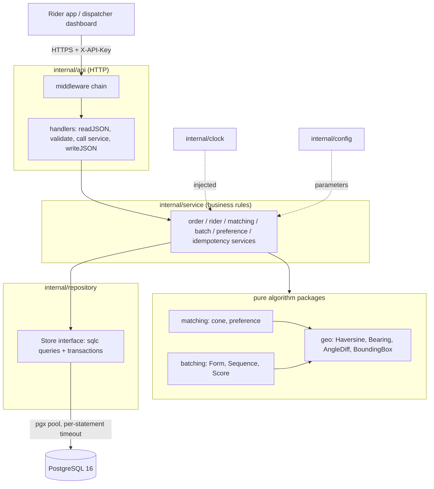
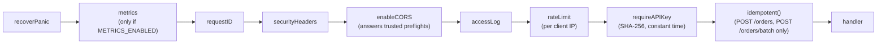
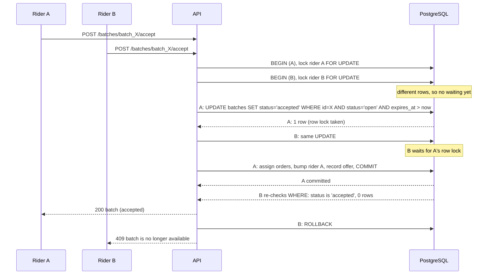
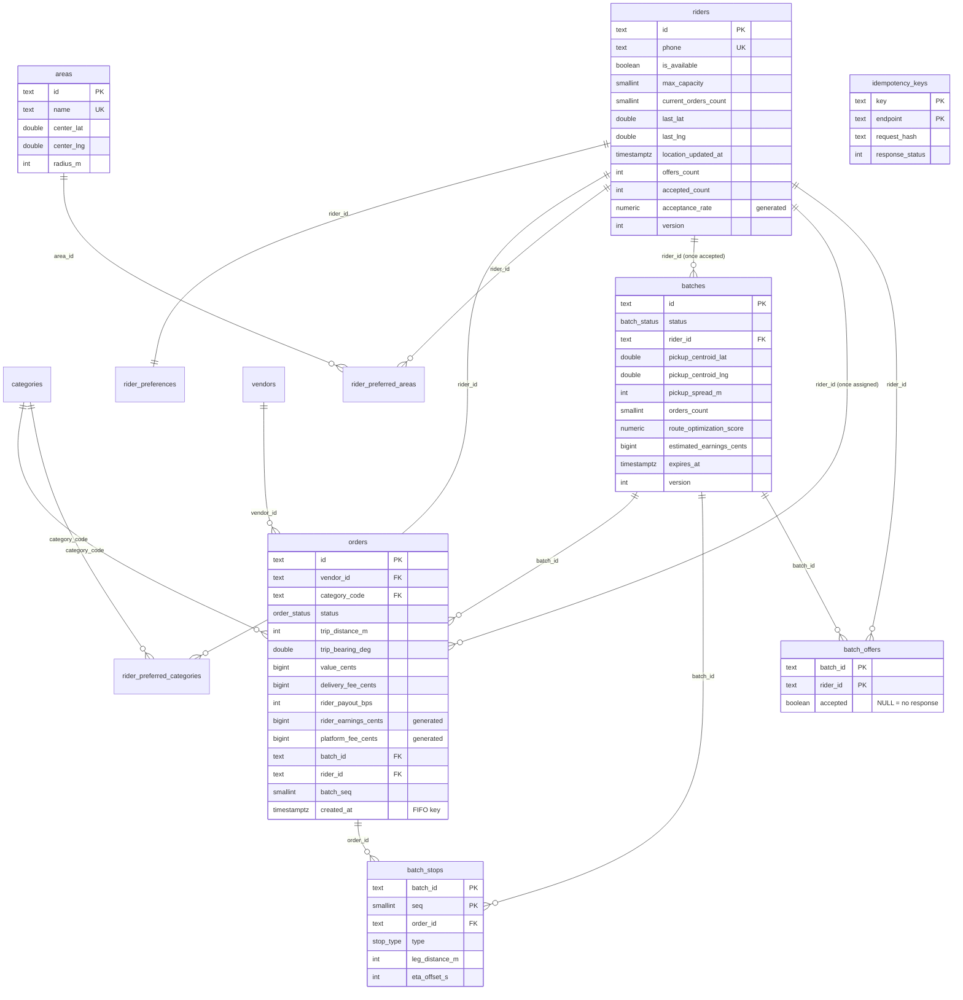

# Zemi Fleet V2: Documentation

The reference for the Zemi Fleet V2 backend. The [README](../README.md) is the quick start; the OpenAPI contract is [`api/openapi.yaml`](../api/openapi.yaml) (Swagger UI at `/docs`).

**Contents**

1. [Overview](#overview)
2. [Architecture](#architecture)
3. [API Reference](#api-reference)
4. [Algorithm Logic](#algorithm-logic)
5. [Setup](#setup)
6. [Database Schema](#database-schema)
7. [Security](#security)
8. [Assumptions](#assumptions)
9. [Performance baseline](#performance-baseline)
10. [Improvements](#improvements)

---

## Overview

Zemi Fleet V2 is the backend for the Zemi Africa rider app: a Go REST API under `/api/v2` backed by PostgreSQL. Vendors' orders arrive as
`pending`; the API groups them into batches, tells a moving rider which pickups are right ahead of them, and ranks riders for a new order.
It was built as a five-day volunteer assignment and is graded on code quality, algorithm correctness (including the edge cases: no
orders, a rider at capacity), API design, documentation and extras (tests, Docker, Swagger, rate limiting, logging). Nothing the
algorithms use is hard-coded: every radius, angle, weight, limit and timeout is an environment variable (see "Configuration reference").

| Feature | Endpoint | In one line |
|---|---|---|
| **Order batching** | `POST /orders/batch` | Up to 5 pending orders whose pickups are all within 2 km of each other and whose trips head in similar directions, oldest first, with a suggested stop sequence, total distance, earnings and `route_optimization_score` |
| **Proximity matching** | `POST /riders/match-orders` | Pending pickups at most 1 km from a moving rider and within ±30° of their bearing (a 60° cone), nearest first, then oldest first; plus `can_accept_more_orders` and `max_additional_orders` |
| **Preference matching** | `POST /orders/match-riders` | Riders ranked for an order by category, area, minimum order value, distance and acceptance rate, best first |
| **Exclusive acceptance** | `POST /batches/:id/accept` | The first rider to accept a batch gets it; everyone after gets `409` |

### Clarifications from Zemi (Raphael, 12 October)

These came after the brief and **override it** where they differ.

1. **Batches are open offers.** Any eligible rider near the vendor can see a batch. The first rider to accept gets it exclusively; anyone
   after that gets `409`. The goal is to minimise travel to the vendor and overall delivery time.
2. **The 2 km rule clusters pickup points.** Deliveries that are close together or on the same route are a bonus, not a requirement.
   (So direction similarity is a tolerance, not a delivery-cluster test.)
3. **Areas are a centre point plus a coverage radius** of a few km (Kilimani, Westlands, ...). The service covers all of Nairobi and its
   surroundings, so an area is a circle that may overlap its neighbours, not a polygon or an administrative boundary.
4. **Earnings:** the rider gets **90% of the delivery fee** and the platform keeps 10%. This is `RIDER_PAYOUT_BPS=9000`, and the value in
   force is snapshotted on each order so a later change never rewrites history.

### Conventions used everywhere

- **Money** is KES `BIGINT` cents in the database and `int64` in Go; the API shows KES. No floats for money; amounts have at most 2 decimals.
- **Distances** are metres in the database and kilometres in the API. **Bearings** are degrees in `[0, 360)`, stored as `DOUBLE PRECISION`.
- **Time is UTC everywhere**, in the database session, in code and on the wire (RFC 3339 with a `Z`: `2026-10-13T09:30:15Z`). Only
  `internal/clock` reads the system clock, and services receive it by injection, so tests control time exactly. `APP_TIMEZONE` (default
  `Africa/Nairobi`) names the business zone for presentation and day boundaries and never changes what is stored or serialised.
- **IDs** are application-generated, prefixed and time-sortable: `ord_...`, `rider_...`, `batch_...`, `ven_...`, `area_...`.
- **Field names** are `snake_case` and follow the brief exactly (`estimated_earnings_kes`, `angle_from_rider_degrees`, ...).

**Stack:** Go 1.26 (Gin, pgx/v5, sqlc, golang-migrate, Viper, log/slog), PostgreSQL 16, testify, go.uber.org/mock and go-faker. The HTTP layer
and build process follow *Let's Go Further*; the data layer follows Tech School's *Simple Bank*.

---

## Architecture

### Layers

Layers only call downward. Handlers never run SQL and services never touch `gin.Context`. The algorithm packages are **pure**: no HTTP,
no database, no config or clock imports. Everything they need is an argument, so they are table-driven-testable in isolation.



`internal/app.Build` wires config, pool, store, clock, services and router; `cmd/api` and the end-to-end tests both use it, so the tests run
the real wiring.

### Middleware chain

Every request passes the same chain, in this order (`internal/api/routes.go`). Order matters: a panic anywhere below becomes a logged
500; the request ID exists before anything logs; a trusted origin's key-less browser preflight is answered before the limiter and
authentication; guessing keys is rate limited because the limiter runs first; an unauthenticated request never reaches idempotency
storage, a service or the database.



### Two riders racing to accept one batch

The winner is decided by one conditional `UPDATE` in the database, not by application code. The rider row is always locked first and the
batch second, so two accepts cannot deadlock.



### Project structure

```
cmd/api/main.go            config -> logger -> pgx pool -> app.Build -> http.Server; `-version` flag
api/                       openapi.yaml (the contract) and embed.go (served at /openapi.yaml)
internal/
  app/                     Build: the real wiring, shared by main and the e2e tests
  config/                  Viper: env vars > app.env > defaults; validated at startup (API keys, CORS, limiter, cone, batch, match)
  api/                     HTTP layer: routes.go, handlers, DTOs, middleware (auth, CORS, rate limit, logging, metrics,
                           idempotency), errors.go (every error response), ids.go (ID patterns), docs.go (Swagger UI)
  service/                 order, rider, matching, batch, preference and idempotency services, mappers
  repository/              Store interface, sqlc-generated code (sqlc/), transactions (create / accept / expire batches),
                           timeout, UTC and not-found DBTX wrappers
  domain/                  shared types and domain errors (ErrNotFound, ErrEditConflict, ErrBatchTaken, ErrRiderAtCapacity, ...)
  geo/                     pure: Haversine, Bearing, AngleDiff, WithinCone, BoundingBox
  matching/                pure: cone.go (60° cone), preference.go (hard filters + score)
  batching/                pure: batcher.go (Form), sequencer.go (Sequence), scoring.go (Score)
  clock/                   Real and Test clocks: the only reader of the system time
  logging/                 context-aware slog handler, phone masking
  metrics/                 nil-safe expvar domain counters
  validator/               the book's Validator
  util/                    prefixed, time-sortable IDs
  mock/                    mockgen output for repository.Store
  testdb/                  test-database helpers (refuse any database not named *_test)
  e2e/                     whole-API scenarios, SQL invariants, OpenAPI contract test
db/migrations/             000001_init_schema, 000002_idempotency (up and down)
db/query/                  sqlc input SQL
db/seed/seed.sql           Nairobi demo data (6 vendors, 10 riders, 40 pending orders)
db/testdata/reference.sql  reference data for tests
postman/                   collection (captured examples) and environment
scripts/                   smoke_test.sh, postman_capture.py, vulncheck.sh
.github/workflows/         test.yml (quality gate), deploy.yml (build, release, deploy)
Dockerfile, docker-compose.yml, Makefile, sqlc.yaml, .env.example
docs/                      DOCUMENTATION.md (this file), TESTING.md
```

---

## API Reference

The machine-readable contract is [`api/openapi.yaml`](../api/openapi.yaml) (OpenAPI 3.0.3). A running server shows it as **Swagger UI at
`/docs`** (for example <http://localhost:8080/docs>) and serves the file at `/openapi.yaml`. The Postman collection in
[`postman/`](../postman) has a request for every endpoint with saved example responses. This section is the human-readable version; the
examples below were captured from the running demo stack (`docker compose --profile demo up --build`).

### Conventions

**Base URL and versioning.** Everything is under `/api/v2`; the major version is in the path, so a breaking change would be `/api/v3`
beside it. Operations routes (`/docs`, `/openapi.yaml`, `/debug/vars`) sit outside it. `GET /healthz` reports the build `version`.

**Authentication.** Send `X-API-Key: <key>` on every request except `GET /api/v2/healthz` and the docs pages. A missing or wrong key
is `401 {"error":"invalid or missing API key"}` with `WWW-Authenticate: ApiKey realm="zemi-fleet"`. The demo stack accepts
`zemi-demo-key-not-for-production-0001`. See "Authentication" under Security.

**Success.** A JSON object with a named key (`{"batches": [...]}`, `{"rider": {...}}`, `{"order": {...}}`), never a bare array. Arrays are
`[]`, never `null`.

**Errors.** One shape, with the HTTP status carrying the class:

```json
{ "error": "batch is no longer available" }
{ "error": { "category": "must be provided", "value_kes": "must be provided" } }
```

| Status | Meaning |
|---|---|
| `400` | Malformed JSON, unknown field, body over 1 MiB, malformed header (`Idempotency-Key`, `X-Expected-Version`) |
| `401` | Missing or wrong API key |
| `404` | Unknown or malformed ID, unknown route |
| `405` | Method not supported (JSON, with the method named) |
| `409` | Edit conflict (stale `version`), batch already taken or expired, or an idempotent request still in progress |
| `422` | Validation failure (field map), rider at capacity or off shift, idempotency key reused with a different body |
| `429` | Rate limit exceeded (`Retry-After` in seconds) |
| `500` | Unexpected error: always the fixed message *"the server encountered a problem and could not process your request"*; details are only in the server log |
| `503` | `healthz` only: the database is down |

**Headers.**

| Header | Direction | Meaning |
|---|---|---|
| `X-API-Key` | request | The API key |
| `Idempotency-Key` | request | `POST /orders` and `POST /orders/batch`: 1 to 64 visible ASCII characters; a retry replays the first response (see "Idempotency" below) |
| `X-Expected-Version` | request | On the rider `PATCH`/`PUT` routes: reject with `409` if the rider's stored `version` differs |
| `X-Request-ID` | both | Kept if 1 to 64 of `A-Z a-z 0-9 . _ -`, otherwise replaced; echoed on every response and carried in every log line |
| `Location` | response | `POST /orders`: the new order's URL |
| `Idempotent-Replay: true` | response | The response was replayed from an earlier request with the same key |
| `Retry-After` | response | `429`: seconds to wait |
| `WWW-Authenticate` | response | `401` |

**Optimistic locking.** Riders carry a `version`. Every write bumps it, and a write that loses a race gets `409`. Send
`X-Expected-Version: <n>` on `PATCH /riders/:id/location`, `PATCH /riders/:id/availability` and `PUT /riders/:id/preferences` to be
rejected when your copy is stale. The one exception is `POST /riders/match-orders`, which records the rider's position without a version
check (telemetry must never `409`).

**Validation.** Every ID in a path or body must match its format (`rider_...`, `ord_...`, `batch_...`, `ven_...`, `area_...`); money is
KES with at most 2 decimals and at most `ORDER_MAX_VALUE_KES` / `ORDER_MAX_DELIVERY_FEE_KES`; coordinates, bearings, speeds, `page`,
`page_size`, `radius_km` and `max_orders` are range-checked; list inputs are capped at 50 entries. Each failure is a `422` with one message
per field.

### Endpoints

In the examples, `KEY` is `zemi-demo-key-not-for-production-0001` and `localhost:8080` is the Docker stack (`localhost:4000` for `make dev/run`).
The seeded orders are `ord_001` to `ord_040`, the riders `rider_001` to `rider_010`, the vendors `ven_001` to `ven_006`.

#### `GET /healthz`: liveness and database check (no key needed)

```bash
curl -s localhost:8080/api/v2/healthz
```
```json
{ "status": "available", "system_info": { "database": "up", "environment": "staging", "version": "docker" } }
```
`503` with `"database": "down"` when PostgreSQL cannot be reached. Exempt from the rate limiter.

#### `POST /orders`: create a pending order

The pickup is snapshotted from the vendor. `201` with a `Location` header. Unknown vendor or category, or a trip shorter than
`ORDER_MIN_TRIP_M`, is `422`. Honours `Idempotency-Key`.

```bash
curl -s -H "X-API-Key: $KEY" -X POST localhost:8080/api/v2/orders \
  -d '{"vendor_id":"ven_001","category":"electronics","delivery_location":{"lat":-1.2900,"lng":36.8100},"value_kes":5000,"delivery_fee_kes":250}'
```
```json
{
  "order": {
    "id": "ord_01M4VFEA32SJN481F7NW", "vendor_id": "ven_001", "category": "electronics", "status": "pending",
    "pickup_location": { "lat": -1.2635, "lng": 36.803 }, "delivery_location": { "lat": -1.29, "lng": 36.81 },
    "trip_distance_km": 3.048, "trip_bearing_degrees": 165.2,
    "value_kes": 5000, "delivery_fee_kes": 250, "rider_payout_percent": 90,
    "estimated_earnings_kes": 225, "platform_fee_kes": 25,
    "batch_id": null, "rider_id": null, "created_at": "2026-10-13T20:32:09.826571Z", "version": 1
  }
}
```
A missing field is `422 {"error":{"category":"must be provided","delivery_fee_kes":"must be provided","delivery_location":"must be provided","value_kes":"must be provided"}}`.

#### `GET /orders/:id`: one order

Same `{"order": {...}}` as above (`status` moves through `pending`, `batched`, `assigned`, ...; `batch_id` and `rider_id` fill in as it does).
`404` for an unknown or malformed ID.

#### `POST /orders/batch`: form batches and offer them to a rider

Body: `rider_id`, `rider_location {latitude, longitude}`, `max_orders` (1 to `BATCH_MAX_ORDERS`), `radius_km` (the pairwise pickup radius, up to
`BATCH_PICKUP_RADIUS_KM`). Returns the open batches on offer to this rider, nearest first. A rider who is off shift or full gets
`{"batches": []}`. Unknown rider is `404`. Honours `Idempotency-Key`. See "Order batching" for the rules and a worked example.

```bash
curl -s -H "X-API-Key: $KEY" -X POST localhost:8080/api/v2/orders/batch \
  -d '{"rider_id":"rider_001","rider_location":{"latitude":-1.2650,"longitude":36.8038},"max_orders":5,"radius_km":2}'
```
```json
{
  "batches": [
    {
      "batch_id": "batch_01M4VFFV3PX779CYM9S2",
      "orders": [
        { "order_id": "ord_034", "pickup": { "lat": -1.266, "lng": 36.8045 }, "delivery": { "lat": -1.275, "lng": 36.846 }, "distance_km": 4.72, "estimated_time_min": 20 },
        { "order_id": "ord_035", "pickup": { "lat": -1.2635, "lng": 36.803 }, "delivery": { "lat": -1.222, "lng": 36.896 }, "distance_km": 11.32, "estimated_time_min": 47 }
      ],
      "sequence": [
        { "seq": 1, "type": "pickup",   "order_id": "ord_034", "location": { "lat": -1.266, "lng": 36.8045 } },
        { "seq": 2, "type": "pickup",   "order_id": "ord_035", "location": { "lat": -1.2635, "lng": 36.803 } },
        { "seq": 3, "type": "delivery", "order_id": "ord_034", "location": { "lat": -1.275, "lng": 36.846 } },
        { "seq": 4, "type": "delivery", "order_id": "ord_035", "location": { "lat": -1.222, "lng": 36.896 } }
      ],
      "total_distance_km": 13.37,
      "distance_saved_km": 2.67,
      "estimated_earnings_kes": 612,
      "route_optimization_score": 0.881,
      "distance_to_first_pickup_km": 0.14,
      "expires_at": "2026-10-13T20:43:00.022408Z"
    }
  ]
}
```
(The real response holds every batch near the rider; one is shown.)

#### `GET /batches?lat=&lng=`: open batches near a point (read-only)

Query: `lat`, `lng` (required), `radius_km` (default `BATCH_VISIBILITY_RADIUS_KM`, at most `BATCH_SEARCH_RADIUS_KM`), `page` (default 1),
`page_size` (default 20, 1 to 50). Each batch has the same shape as above; the response adds the book's pagination block.

```bash
curl -s -H "X-API-Key: $KEY" "localhost:8080/api/v2/batches?lat=-1.2650&lng=36.8038&radius_km=1&page_size=1"
```
```json
{ "batches": [ { "batch_id": "batch_01M4VFFV3PX779CYM9S2", "...": "as above" } ],
  "metadata": { "current_page": 1, "page_size": 1, "first_page": 1, "last_page": 4, "total_records": 4 } }
```

#### `POST /batches/:id/accept`: accept a batch exclusively

Body `{"rider_id": "rider_001"}`. The first rider to accept wins and gets `200` with the batch (`status: accepted`, `rider_id`, `accepted_at`, plus the
fields above, without `distance_to_first_pickup_km`). A retry by the winner is `200` again. Everyone else: `409 {"error":"batch is no longer available"}`
(taken, or expired). `422` if the rider is off shift (`rider is not available`) or the batch would exceed their capacity. Unknown batch or rider is `404`.
See "Exclusive batch acceptance".

```bash
curl -s -H "X-API-Key: $KEY" -X POST localhost:8080/api/v2/batches/batch_01M4VFFV3PX779CYM9S2/accept -d '{"rider_id":"rider_001"}'
```
```json
{ "batch": { "batch_id": "batch_01M4VFFV3PX779CYM9S2", "status": "accepted", "rider_id": "rider_001",
             "accepted_at": "2026-10-13T20:33:15.869732Z", "orders": ["..."], "sequence": ["..."],
             "total_distance_km": 13.37, "distance_saved_km": 2.67, "estimated_earnings_kes": 612,
             "route_optimization_score": 0.881, "expires_at": "2026-10-13T20:43:00.022408Z" } }
```

#### `POST /riders/match-orders`: pickups inside the cone ahead of a moving rider

Body: `rider_id`, `current_location {latitude, longitude}`, `bearing_degrees` (0 to 360, optional), `speed_kmh` (optional), `current_orders_count` (0 to 5).
The rider's position is recorded as a side effect. See "Proximity matching (60° cone)".

```bash
curl -s -H "X-API-Key: $KEY" -X POST localhost:8080/api/v2/riders/match-orders \
  -d '{"rider_id":"rider_001","current_location":{"latitude":-1.2650,"longitude":36.8038},"bearing_degrees":340,"speed_kmh":18,"current_orders_count":0}'
```
```json
{
  "matching_orders": [
    { "order_id": "ord_036", "pickup_location": { "lat": -1.266, "lng": 36.8045 }, "distance_from_rider_km": 0.18,
      "angle_from_rider_degrees": 4.2, "order_age_minutes": 14, "estimated_earnings_kes": 234 }
  ],
  "can_accept_more_orders": true,
  "max_additional_orders": 5,
  "direction_filter_applied": true
}
```
(Illustrative values; on a fresh seed it returns what is pending ahead of the rider, and `matching_orders: []` once those orders are batched.)
A rider at capacity or off shift gets `matching_orders: []`, `can_accept_more_orders: false`, `max_additional_orders: 0`.

#### `POST /orders/match-riders`: rank riders for an order

Body: `order_details {category, pickup_location {lat,lng}, delivery_location {lat,lng}, value_kes}` for an order that is not saved yet, **or** `order_id`
of a stored one (details win if both are sent). See "Preference matching".

```bash
curl -s -H "X-API-Key: $KEY" -X POST localhost:8080/api/v2/orders/match-riders \
  -d '{"order_details":{"category":"electronics","pickup_location":{"lat":-1.2917,"lng":36.7878},"delivery_location":{"lat":-1.2900,"lng":36.7920},"value_kes":5000}}'
```
```json
{
  "matching_riders": [
    { "rider_id": "rider_002", "match_score": 0.96, "matching_preferences": ["electronics", "Kileleshwa", "Kilimani", "Lavington"],
      "current_orders_count": 2, "distance_to_pickup_km": 0.39, "acceptance_rate": 0.88 },
    { "rider_id": "rider_010", "match_score": 0.73, "matching_preferences": [], "current_orders_count": 0, "distance_to_pickup_km": 0.25, "acceptance_rate": 0.857 },
    { "rider_id": "rider_008", "match_score": 0.33, "matching_preferences": [], "current_orders_count": 0, "distance_to_pickup_km": null, "acceptance_rate": 0 }
  ]
}
```
(Two more riders omitted.) `distance_to_pickup_km` is `null` when the rider's location is older than `RIDER_LOCATION_STALE_AFTER`.

#### `GET /riders/:id`: a rider with preferences

```bash
curl -s -H "X-API-Key: $KEY" localhost:8080/api/v2/riders/rider_002
```
```json
{
  "rider": {
    "id": "rider_002", "full_name": "Mercy Wanjiru", "phone": "+254722000002", "is_available": true,
    "max_capacity": 5, "current_orders_count": 2, "max_additional_orders": 3,
    "current_location": { "lat": -1.289, "lng": 36.79 }, "bearing_degrees": 180, "speed_kmh": 18,
    "location_updated_at": "2026-10-13T20:25:12.033937Z", "acceptance_rate": 0.88,
    "preferences": { "min_order_value_kes": 500, "preferred_categories": ["clothing", "electronics", "fragile"],
                     "preferred_areas": ["area_001", "area_004", "area_006"] },
    "version": 1
  }
}
```
All three rider write routes below return this same `{"rider": {...}}` with the new `version`.

#### `PATCH /riders/:id/location`: report position

Body: `latitude`, `longitude` (required), `bearing_degrees`, `speed_kmh` (optional). An omitted bearing or speed is stored as unknown (`null`): they
describe that one reading. Optional `X-Expected-Version`; stale is `409`.

```bash
curl -s -H "X-API-Key: $KEY" -X PATCH localhost:8080/api/v2/riders/rider_002/location \
  -d '{"latitude":-1.2890,"longitude":36.7900,"bearing_degrees":45,"speed_kmh":20}'
```

#### `PATCH /riders/:id/availability`: go on or off shift

```bash
curl -s -H "X-API-Key: $KEY" -X PATCH localhost:8080/api/v2/riders/rider_002/availability -d '{"is_available":true}'
```

#### `PUT /riders/:id/preferences`: replace preferences

Replaces the whole set. Empty lists mean "no preference" (matches everything). Unknown category or area is `422`.

```bash
curl -s -H "X-API-Key: $KEY" -X PUT localhost:8080/api/v2/riders/rider_002/preferences \
  -d '{"min_order_value_kes":500,"preferred_categories":["electronics"],"preferred_areas":["area_001"]}'
```

#### Operations routes

| Route | Purpose |
|---|---|
| `GET /docs` | Swagger UI (no key; `DOCS_ENABLED`) |
| `GET /openapi.yaml` | The contract (no key; `DOCS_ENABLED`) |
| `GET /debug/vars` | expvar metrics (needs a key; `METRICS_ENABLED`); see "Metrics" |

### Idempotency

`POST /orders` and `POST /orders/batch` accept an `Idempotency-Key` header (1 to 64 visible ASCII characters), so a
client that times out and retries cannot create a second order or form a second set of batches. Without the header
nothing changes.

| Situation | Result |
|---|---|
| New key | The request runs normally. The key is **claimed first** (an atomic `INSERT ... ON CONFLICT DO NOTHING`), so two simultaneous requests with one key cannot both run |
| Same key, same body, after the first finished | The stored response is **replayed**: same status, same body, same `Location`, plus `Idempotent-Replay: true`. Nothing is executed |
| Same key, **different** body | `422`, field `idempotency_key` |
| Same key, same body, first still running | `409`, retry shortly |
| First request failed (any non-2xx) | The key is **released**: the failure is not stored, so the corrected retry runs |
| A claim whose request never finished (a crash) | After `IDEMPOTENCY_PROCESSING_TIMEOUT` (2m) another request with the same body takes it over |
| Key older than `IDEMPOTENCY_TTL` (24h) | Ignored; expired keys are deleted whenever a new key is written |
| Malformed key (a space, a control or non-ASCII character, or more than 64 characters) | `400` |

A key is scoped to its endpoint (`/api/v2/orders` and `/api/v2/orders/batch` are independent). "Same body" means the
same JSON after whitespace is removed (a retry that only re-indents still matches; reordering keys does not). Storage:
table `idempotency_keys` (`key`, `endpoint`, `request_hash`, `response_status`, `response_body`, `response_headers`,
`created_at`), migration `000002_idempotency`. A replayed `POST /orders/batch` returns the batches as they were when
first computed, which may have since been accepted or expired; send a new key for a fresh result.

### Contract, Swagger UI, Postman and the smoke test

#### OpenAPI (`api/openapi.yaml`)

The contract is a hand-written OpenAPI 3.0.3 document, embedded in the binary and served at `GET /openapi.yaml`. It describes every route
(including `/debug/vars`, `/docs` and `/openapi.yaml`), a reusable schema for every request and response in the exact field names and key
order the API returns, the `ApiKeyAuth` scheme (`X-API-Key`, applied globally; `healthz` and the two documentation routes override it
to none), the `Idempotency-Key`, `X-Expected-Version` and `X-Request-ID` headers, every error status each route can return
(400/401/404/409/422/429/500, plus 503 on healthz) and examples taken from the demo seed. Errors share one `Error` schema whose `error` is
either a string or an object of field name to message.

Three tests keep it honest, so it cannot drift from the code:

- **Unit (`internal/api/openapi_test.go`):** the spec loads and validates (structure, every `$ref`, every example against its schema);
  security is global with only the three public routes overriding it; every operation documents 401/429/500; and **route parity**: every
  route Gin registers appears in the spec and every spec path is registered, failing on any difference in either direction.
- **Contract (`internal/e2e/contract_test.go`, kin-openapi `openapi3filter`):** the real responses of `match-orders`, `orders/batch`,
  `match-riders`, `GET /batches`, `accept` (200 and 409), the rider routes, `healthz`, `/debug/vars` and the error forms (422 with the
  field map, 404, 401) are validated against the spec: documented status, body and headers. Response schemas set
  `additionalProperties: false`, so a new undocumented field fails the test.

#### Swagger UI (`GET /docs`)

`DOCS_ENABLED` controls `GET /docs` and `GET /openapi.yaml`: when unset it is true in development and staging and false in production
(then both are `404`). They need **no API key**, because they describe the API and hold no data (use the **Authorize** button to give
"Try it out" a key), but they are still rate limited. The page is an embedded HTML file that loads `swagger-ui-dist` from jsDelivr, pinned to
an exact version with Subresource Integrity hashes. Its Content-Security-Policy allows scripts only from that CDN plus the page's own
initialisation script (by hash, so no `unsafe-inline` for scripts), connections only to the same origin, and no framing. `style-src`
allows `unsafe-inline` because Swagger UI sets inline style attributes.

#### Postman (`postman/`)

`Zemi_Fleet_V2.postman_collection.json` (v2.1) uses collection-level API-key auth (`{{api_key}}`) and the variable `{{base_url}}`, with
folders Health, Orders, Order Batching, Batches, Proximity Matching, Rider Matching, Rider Preferences and Metrics. The matching folders
start with a "0. Setup" request that reports the rider's location (seeded locations go stale). Every request has test scripts for the status and
key fields, and saved example responses (one success and the main error cases). The idempotency replay and the accept race (rider A wins,
rider B gets `409`, the `batch_id` passed on through a collection variable) are requests of their own. **The examples are captured, not
written:** `scripts/postman_capture.py` runs the requests in order against a freshly seeded stack and stores what came back.
`make staging/postman` runs the collection with a pinned `newman`; reseed first (`make staging/seed`), since a run uses up some demo data.
`Zemi_Fleet_V2.postman_environment.json` holds `base_url` (`http://localhost:8080`) and the demo key.

#### Smoke test (`scripts/smoke_test.sh`)

Calls every endpoint once with the key and checks the status code, stopping at the first failure and printing what was expected and what came
back. `make staging/smoke` runs it against the staging stack. It needs the demo seed and it writes (an order and an accepted one-order batch for
`rider_010`, who has room for four, so it can run a few times in a row; reseed to reset).

---

## Algorithm Logic

The three features and the acceptance rule. The pure algorithms live in `internal/geo`, `internal/matching` and `internal/batching` and are exercised with table-driven tests; the services feed them from the database.

### Proximity matching (60° cone)

`POST /api/v2/riders/match-orders` answers: *"which pending pickups are close and roughly ahead of this
moving rider?"* The pure algorithm lives in `internal/matching/cone.go` (no database, config or HTTP
imports); `internal/service/matching_service.go` feeds it from the database.

#### The cone

```
                      heading (bearing_degrees)
                              ^
                    -30 deg   |   +30 deg
                        \     |     /
                         \    |    /       . order C   (outside: 41 deg off heading)
              order A     \   |   /
              (in, 12 deg) \  |  /   order B (in, exactly 30 deg: edge is inclusive)
                    .       \ | /      .
                             \|/
                          [ RIDER ]  ------ radius (CONE_RADIUS_KM, inclusive) ------>
                              |
                              |            . order D  (behind: outside the cone)
                              v
```

Defaults: radius 1 km, half angle 30 degrees (so a 60 degree cone). Angles are measured from the
rider's heading, clockwise positive, and wrap correctly across north: a heading of 350 degrees and a
pickup at bearing 10 degrees are 20 degrees apart, not 340.

#### Steps

1. **Record the rider's position.** The call stores the position, bearing, speed and a clock timestamp
   on the rider (same rules as `PATCH /riders/:id/location`: an omitted bearing or speed is stored as
   `NULL`). It deliberately does **not** use the optimistic version check and does not bump the rider's
   version, so a location ping can never fail with `409` and never makes the rider's own versioned
   writes conflict.
2. **Capacity check.** A rider who is unavailable, or whose stored `current_orders_count` has reached
   `max_capacity`, gets `matching_orders: []`, `can_accept_more_orders: false` and
   `max_additional_orders: 0`. The candidate query is not run.
3. **Candidates from SQL.** Pending orders (`status = 'pending'` only, so anything already batched or
   assigned is excluded) whose pickup lies inside the bounding box of the radius around the rider
   (`geo.BoundingBox`). The literal `status = 'pending'` plus the lat/lng range lets Postgres use the
   partial index `idx_orders_pending_pickup`. The box is only a cheap prefilter; it is slightly larger
   than the circle.
4. **Distance filter.** Exact great-circle distance (`geo.Haversine`); keep pickups at distance
   **<= radius** (inclusive).
5. **Direction filter (the cone), when it applies:** keep pickups whose bearing from the rider is within
   `CONE_HALF_ANGLE_DEG` of the rider's heading, **inclusive** at exactly the half angle
   (`geo.WithinCone`). Each match reports its absolute angle (0 to 30) in `angle_from_rider_degrees`.
6. **Sort** by distance ascending, then `created_at` ascending (oldest first, FIFO), then `order_id`,
   so the same input always gives the same order.
7. **Cap** at `CONE_MAX_RESULTS`.

#### The fallback rule (when the cone is *not* used)

The cone is skipped (the matcher uses the **full circle**: distance filter only, and returns
`direction_filter_applied: false` and `angle_from_rider_degrees: null` for every match) in exactly two cases:

- the **bearing is null/omitted**: there is no direction to filter on;
- a **speed is reported and is below `CONE_MIN_SPEED_KMH`** (default 3).

A bearing with **no speed** uses the cone: nothing says the heading is noise, so it is trusted.

Why: a GPS heading is derived from movement. A stationary or very slow rider has a heading that is noise,
and cutting their results to a random 60 degree wedge would hide orders next to them.

#### The authoritative count

`can_accept_more_orders` and `max_additional_orders` (`max_capacity - current_orders_count`) always come
from the **database**. The server is what assigns orders, so its count cannot be stale the way a phone's
can. The request's `current_orders_count` is validated (0 to 5) but is **never used for a decision**; if
it disagrees with the stored count, a warning is logged (`rider reported a different order count than
the server holds`) and the request carries on.

#### Response

Example (illustrative values):

```json
{
  "matching_orders": [
    {
      "order_id": "ord_036",
      "pickup_location": { "lat": -1.266, "lng": 36.8045 },
      "distance_from_rider_km": 0.18,
      "angle_from_rider_degrees": 4.2,
      "order_age_minutes": 14,
      "estimated_earnings_kes": 234.0
    }
  ],
  "can_accept_more_orders": true,
  "max_additional_orders": 5,
  "direction_filter_applied": true
}
```

- `distance_from_rider_km` is rounded to 2 decimals, `angle_from_rider_degrees` to 1.
- `order_age_minutes` is whole minutes (floored) from the injected clock to the order's `created_at`;
  it is never negative.
- `estimated_earnings_kes` is the order's `rider_earnings_cents` (the rider's 90% share, snapshotted on
  the order) shown as KES.
- `matching_orders` is always an array, `[]` when there is nothing to show.

The cone's edge cases and the assumptions behind them are listed under "Assumptions".

### Order batching

`POST /api/v2/orders/batch` offers a rider batches of up to 5 pending orders that are picked up close
together and delivered in similar directions. The pure algorithm is `internal/batching`
(`batcher.go`, `sequencer.go`, `scoring.go`: no DB, config or clock imports); the transaction that feeds
it is `internal/repository/tx_create_batches.go`.

#### Steps

1. **Rider checks.** Unknown rider gives 404. A rider who is off shift or at capacity gets
   `{"batches": []}` and no transaction runs. Otherwise the effective batch size is
   `min(max_orders, max_capacity - current_orders_count)`, using the database's counts.
2. **Expire.** In one transaction, every open batch whose `expires_at <= now` (clock time) becomes
   `expired` and its orders go back to `pending` (`batch_id` and `batch_seq` cleared).
3. **Select.** Pending orders whose pickup is within `BATCH_SEARCH_RADIUS_KM` of the rider (bounding box
   in SQL, exact haversine in Go), oldest first, `FOR UPDATE SKIP LOCKED`. If two riders ask at the same
   moment, the second simply skips rows the first holds, so no order is ever batched twice.
4. **Form** (`batching.Form`): described below.
5. **Store.** Insert each batch (`status = 'open'`, no rider, pickup centroid, `pickup_spread_m`,
   `expires_at = now + BATCH_TTL`), its stops, and mark its orders `batched` with `batch_id` and
   `batch_seq` (their FIFO rank).
6. **Offer.** The rider is shown the new batches plus any still-open batches whose first pickup is
   within `BATCH_SEARCH_RADIUS_KM` and whose size fits their effective size. A `batch_offers` row is
   written per batch (once: asking again does not duplicate it or inflate `riders.offers_count`).
7. **Sort** by `distance_to_first_pickup_km` (rider to the route's first stop), then by the batch's
   oldest order (FIFO).

A batch stays `open`, assigned to nobody, until a rider accepts it (see "Exclusive batch acceptance"). Anyone
near the vendor may see it; the first to accept gets it exclusively.

#### Listing open batches (`GET /api/v2/batches`)

`?lat=&lng=` (required), `radius_km` (default `BATCH_VISIBILITY_RADIUS_KM`, at most `BATCH_SEARCH_RADIUS_KM`),
`page` (default 1) and `page_size` (default 20, 1 to 50). It returns the open batches with `expires_at > now`
whose first pickup is within the radius, in the same shape as `POST /orders/batch` (so each carries
`distance_to_first_pickup_km` from the given point), sorted by that distance, then the oldest order's
`created_at`, then `batch_id`, with the book's `metadata` block (`current_page`, `page_size`, `first_page`,
`last_page`, `total_records`; `metadata` is `{}` when nothing matches, as in the book). It is **read-only**: it
records no offers and expires nothing, it only filters on `expires_at`.

#### Forming batches (`Form`)

1. Sort orders by `created_at`, then `id` (**FIFO**).
2. The **seed** is the oldest order not yet in a batch.
3. Walk the remaining unused orders in FIFO order and add one if **both** hold:
   - its pickup is within the radius (`radius_km` from the request, at most `BATCH_PICKUP_RADIUS_KM`)
     of **every pickup already in the batch** (the pairwise rule), and
   - its trip bearing (pickup to delivery) is within `BATCH_DIRECTION_TOLERANCE_DEG` of the **seed's**
     trip bearing (`geo.AngleDiff`, so 350 and 20 degrees are 30 apart).

   Stop at the effective size (never more than `BATCH_MAX_ORDERS`).
4. An order with no partners becomes a batch of one, so it is still offered.
5. Repeat from step 2 until every order is in exactly one batch.

**The pairwise rule and why.** The brief says pickups are "within 2 km *of each other*". Measuring only
from the seed would let A, B and C join when A-B is 1.5 km and A-C is 1.5 km but B-C is 3 km (B and C on
opposite sides of A), which breaks that promise. Checking every pair keeps the whole pickup cluster inside
the radius. Likewise A-B 1.5 km, B-C 1.5 km, A-C 3 km cannot all be one batch.

**Direction tolerance.** Direction is compared with the *seed's* bearing, not the previous member's, so a
batch cannot drift: trips at 0, 40 and 80 degrees are not one batch (80 is 80 from the seed) even though
each is within 45 of its neighbour. A trip shorter than 1 m has no direction and is compatible with any.

**FIFO.** Seeds are taken oldest-first and members are added oldest-first, so when a cluster has more
than 5 orders the 5 oldest share the first batch and nobody who has waited longer is passed over for a
newer order.

#### Sequencing (`Sequence`)

The route starts at the seed's pickup. From the current position it goes to the **nearest feasible
stop**: the pickup of any order not yet collected, or the delivery of an order already collected and not
yet delivered. A delivery is never feasible before its own pickup, so every pickup precedes its delivery.
Ties go to a pickup before a delivery, then to the older order, so the result is deterministic.

#### Scoring (`scoring.go`)

```
route_distance           = sum of the stop-to-stop legs (the first stop has leg 0)
direct(order)            = haversine(order pickup, order delivery)
along(order)             = distance travelled along the route from the order's PICKUP stop
                           to its DELIVERY stop
detour(order)            = min(1, direct(order) / along(order))
route_optimization_score = mean of detour(order) over the batch's orders        (a batch of one = 1.0)
distance_saved_km        = sum(direct(order)) - route_distance                  (negative if batching costs distance)
stop_time (seconds)      = cumulative_distance_to_stop / AVG_SPEED_KMH
                           + STOP_DWELL_MIN * 60 * (number of EARLIER stops)
estimated_time_min       = stop_time of that order's delivery, in minutes (the API rounds up)
estimated_earnings       = sum(rider_earnings_cents)   # 90% of the delivery fees
```

**Why a detour score.** The earlier "sum of trips / route" ratio hit its 1.0 cap for almost every
same-direction batch, so it could not tell batches apart. The detour score asks, per order, "how far does
this parcel actually travel between pickup and drop-off compared with the straight line?" An order delivered
straight after its pickup scores 1.0; one that rides along while the rider visits other stops scores less. The
mean over the batch then genuinely varies. A sequence that delivers immediately after each pickup scores
higher than "pick everything up, then deliver everything" (tested). `distance_saved_km` reports the other
side: how much shorter the batch route is than doing the trips one by one.

The score ignores the deadhead between one order's drop-off and the next pickup, and the distance from the rider
to the first pickup (that is `distance_to_first_pickup_km`).

#### Worked example (seed data, fresh seed, `rider_001` at -1.2650, 36.8038)

The oldest pending order near Westlands is `ord_002` (Sarit Centre to Kasarani, bearing 65.9). It is the
seed. In FIFO order the next unused orders that fit are `ord_003` (Westlands Bites to Eastleigh, bearing
102.2: 36.3 degrees from the seed, pickup 325 m away), `ord_009` and `ord_029` (Sarit to Kasarani again)
and `ord_020` (Westlands Bites to Eastleigh again). That is five orders, so the batch is full:

```
batch   [ord_002, ord_003, ord_009, ord_020, ord_029]          (FIFO order)
route   1P:002 > 2P:009 > 3P:029 > 4P:003 > 5P:020 > 6D:003 > 7D:020 > 8D:002 > 9D:009 > 10D:029    (13.15 km)

order    direct   along the route (pickup stop -> delivery stop)   detour
ord_002  11.32 km   13.15 km  (stop 1 -> stop 8)                    0.861
ord_003   4.72 km    4.72 km  (stop 4 -> stop 6)                    1.000
ord_009  11.32 km   13.15 km  (stop 2 -> stop 9)                    0.861
ord_020   4.72 km    4.72 km  (stop 5 -> stop 7)                    1.000
ord_029  11.32 km   13.15 km  (stop 3 -> stop 10)                   0.861

score   (0.861 + 1.000 + 0.861 + 1.000 + 0.861) / 5 = 0.917
saved   43.41 km of separate trips - 13.15 km route = 30.26 km
time    ord_003 is delivered at stop 6: 16 min of driving + 5 earlier stops x 2 min = 26 min
earn    216 + 396 + 396 + 216 + 396 = 1,620 KES
```

The other batches from the same request score 0.881 to 1.0, e.g. `ord_034` + `ord_035` = 0.881 (one
parcel waits while the rider picks up the second) and `ord_036` + `ord_040` = 1.0.

The next oldest unused order, `ord_004` (Yaya Centre to Madaraka, bearing 121), is both too far from Sarit
(about 3.6 km) and heading a different way (55 degrees off the seed), so it seeds a different batch (`ord_004`,
`ord_005`, `ord_010`, `ord_011`, `ord_013`), and so on. `ord_018` is left over from that cluster (6 Yaya
orders, capacity 5) and becomes a batch of one.


### Preference matching

`POST /api/v2/orders/match-riders` answers: *"which riders would want this order, best first?"* The pure
algorithm is `internal/matching/preference.go` (no DB, config or HTTP imports); the service
(`internal/service/preference_service.go`) loads the riders and their preferences and feeds it.

#### Request

`{"order_id": "...", "order_details": {"category", "pickup_location": {"lat","lng"}, "delivery_location": {"lat","lng"}, "value_kes"}}`

- `order_details` lets the match run for an order that is **not saved yet**. When it is sent it is used, and the
  stored order (if `order_id` names one) is not read: **details win**.
- When `order_details` is omitted, the order is loaded by `order_id` (`404` if unknown). `order_id` is required
  in that case and optional otherwise.
- Validation (`422`): the category must exist; `lat`/`lng` in range; `value_kes` greater than 0 with at most 2
  decimals; pickup and delivery at least `ORDER_MIN_TRIP_M` apart (the same rule as `POST /orders`).

#### Hard filters vs the score, and why

**Preferences are hard filters; the score only ranks the riders who passed them.** The brief says a rider who
prefers "electronics only" must not be offered a food order, and asks for "all riders whose preferences match".
If preferences were just score terms, a nearby rider with a great acceptance rate could outrank the rule and
still appear for an order they said they never take, and the `matching_riders` list would contain people who
will decline. Filtering first keeps the list honest; scoring then orders it. A preference left **empty** means
"accepts everything" (no filter).

Any one of these excludes a rider:

| Filter | Rule |
|---|---|
| Availability | `is_available` is false |
| Capacity | `current_orders_count >= max_capacity` |
| Minimum order value | order `value_kes` is below the rider's minimum (equal is **in**; 1 KES below is out) |
| Category | the rider has category preferences and the order's category is not one of them |
| Area | the rider has area preferences and the pickup is inside none of them (haversine to the area centre `<= radius_m`; **on the boundary is in**) |
| Distance | the rider has a **known, fresh** location farther than `MATCH_MAX_DISTANCE_KM` from the pickup |

#### Location freshness

A rider's location is **fresh** if `location_updated_at` is within `RIDER_LOCATION_STALE_AFTER` (default 30 minutes)
of the clock. A **stale or missing** location counts as **unknown**: the rider is *not* excluded by distance (we
do not know they are far), but they score 0 for proximity and `distance_to_pickup_km` is `null`. A location with no
timestamp cannot be trusted and is treated as unknown. A timestamp slightly in the future (clock skew) counts as fresh.

#### Score

```
category   = 1.0 if the rider explicitly prefers this category, 0.5 if they have no category preference
area       = 1.0 if the pickup is inside an explicitly preferred area, 0.5 if they have no area preference
proximity  = 1 - distance / MATCH_MAX_DISTANCE_KM       (0 if the location is unknown)
acceptance = (accepted + 1) / (offers + 2)               the SMOOTHED acceptance rate; 0.5 for a newcomer

match_score = round2( 0.25*category + 0.20*area + 0.35*proximity + 0.20*acceptance )
```

The weights are `MATCH_WEIGHT_CATEGORY` (0.25), `MATCH_WEIGHT_AREA` (0.20), `MATCH_WEIGHT_PROXIMITY` (0.35) and
`MATCH_WEIGHT_ACCEPTANCE` (0.20). **They must sum to 1.0**; the server refuses to start otherwise (a tolerance of
1e-9 absorbs float noise). The neutral 0.5 means "no opinion": a rider with no preferences sits between a rider who
explicitly wants the order (1.0) and one who would have been filtered out.

**Why smoothed.** Scoring the raw `accepted / offered` rate gives every newcomer 0 and buries them under riders
with any history at all, and gives a rider with one lucky offer a perfect 1.0. `(accepted + 1) / (offers + 2)` (Laplace
smoothing) starts a newcomer at a neutral 0.5 and converges on the real rate as offers accumulate: 1 accepted of 1
offered is 0.67, 0 of 1 is 0.33, 45 of 50 is 0.88, 1 of 20 is 0.09. The response still shows the **raw stored**
`acceptance_rate` (what the rider's record actually is); only the score uses the smoothed value.

**Sorting:** `match_score` descending, then distance ascending with unknown distances last, then `rider_id`. The
sort uses the *rounded* score, the number the client sees, so two riders who both show 0.80 are ordered by distance
rather than by an invisible third decimal. Capped at `MATCH_MAX_RESULTS` (10). `matching_riders` is always an array.

**`matching_preferences`** lists only the *explicit* matches: the category code if the rider prefers it, then the
names of every preferred area that contains the pickup (areas can overlap), e.g. `["electronics","Kilimani"]`. It
is `[]` for a rider with no preferences.

#### Worked example (fresh seed)

An **electronics** order worth **KES 5,000**, picked up at Yaya Centre in Kilimani (-1.2917, 36.7878):

```
filtered out (hard filters)
  rider_001 Brian   prefers electronics, but only the Westlands and Parklands areas: pickup is in neither
  rider_003 Kevin   at capacity (5/5)
  rider_005 Samuel  off shift
  rider_006 Grace   prefers food and documents only
  rider_007 Peter   prefers Upper Hill and South B only

ranked   (acceptance below is the SMOOTHED rate used in the score)
  rider_002 Mercy   0.25*1.0 (prefers electronics)  + 0.20*1.0 (pickup is in Kilimani, Kileleshwa and Lavington, all preferred)
                    + 0.35*(1 - 0.39/10) = 0.336    + 0.20*(23/27 = 0.852) = 0.170   = 0.957  -> 0.96
  rider_010 Aisha   0.25*0.5 (no category pref)     + 0.20*0.5 (no area pref)
                    + 0.35*(1 - 0.25/10) = 0.341    + 0.20*(31/37 = 0.838) = 0.168   = 0.734  -> 0.73
  rider_009 David   0.25*0.5                        + 0.20*0.5
                    + 0.35*(1 - 4.48/10) = 0.193    + 0.20*(49/62 = 0.790) = 0.158   = 0.576  -> 0.58
  rider_004 Faith   0.125 + 0.10 + 0.35*(1 - 5.24/10) = 0.167 + 0.20*(12/14 = 0.857) = 0.171 = 0.563 -> 0.56
  rider_008 Lucy    0.125 + 0.10 + 0 (no location yet) + 0.20*0.5 (no offers yet: neutral) = 0.325 -> 0.33   (distance_to_pickup_km: null)
```

The raw rates shown in the response are 0.88, 0.857, 0.8, 0.917 and 0 (Lucy has no offers), exactly as stored; smoothing
changes the ranking terms, not the numbers reported. Faith's raw 0.917 is the best record of the five, but her 5.24 km
costs her more than it earns her.

At KES 300 Mercy drops out (her minimum order value is KES 500), and a **food** order drops Mercy too and brings
in Grace (prefers food; the pickup is inside her Kileleshwa and Lavington areas).


### Exclusive batch acceptance

`POST /api/v2/batches/:id/accept` with `{"rider_id": "..."}`. Per the client, a batch is an open offer: any
eligible rider near the vendor can see it, and **the first rider to accept gets it exclusively**; everyone
after that gets `409`. The whole decision is one transaction (`internal/repository/tx_accept_batch.go`).

#### Steps

1. **Lock the rider** (`SELECT ... FROM riders WHERE id = $1 FOR UPDATE`). Unknown rider: `404`. Off shift:
   `422 "rider is not available"`.
2. **Read the batch.** Unknown batch: `404`. If this rider already holds it, return it with `200`
   (**idempotent retry**: a client whose response was lost can safely ask again).
3. **Capacity.** `current_orders_count + batch.orders_count > max_capacity` is `422` (`ErrRiderAtCapacity`).
4. **Claim**:

   ```sql
   UPDATE batches
   SET status = 'accepted', rider_id = $rider, accepted_at = $now, version = version + 1
   WHERE id = $batch AND status = 'open' AND expires_at > $now
   RETURNING *;
   ```
5. **No row back?** Re-read the batch: gone is `404`; held by this rider is `200` (idempotent); otherwise
   `409 "batch is no longer available"` (taken by someone else, or expired).
6. **Row back (we won):** set the batch's orders to `assigned` with `rider_id`; `riders.current_orders_count += n`,
   `accepted_count += 1`, `version += 1`; upsert the `batch_offers` row (`accepted = true`, `responded_at = now`),
   inserting it, and counting it in `offers_count`, if the rider was never shown this batch.

All times come from the injected clock.

#### Why the conditional UPDATE guarantees one winner

The exclusivity lives in the `WHERE status = 'open'` of one statement, not in application code. When two
transactions run that UPDATE on the same batch, Postgres lets the first take the row lock and makes the second
**wait**. When the first commits, the second re-evaluates its `WHERE` against the committed row (this is how
`READ COMMITTED` treats a blocked UPDATE), finds `status = 'accepted'`, and updates **zero** rows. There is no
window between "check it is open" and "mark it taken" because they are the same statement. Zero rows is how a
loser learns it lost. Expiry is part of the same predicate (`expires_at > $now`), so an expired batch cannot be
claimed even before anything has marked it `expired`.

#### Lock order

Every accept takes locks in the same order: **rider row first, then batch row**. A transaction never holds a
batch lock while waiting for a rider lock, so two accepts cannot wait on each other in a cycle: no deadlock.
Locking the rider first also serialises two concurrent accepts by the *same* rider, so the second one's
capacity check sees the first one's result and can never push the rider past `max_capacity` (the table's CHECK
constraint is the last line of defence). Different riders racing for one batch only contend on the batch row.

#### Two riders racing

```
 Rider A (tx A)                              Rider B (tx B)                           batches row
 --------------                              --------------                           -----------
 BEGIN                                       BEGIN                                    status=open
 lock rider A FOR UPDATE                     lock rider B FOR UPDATE                  (different rows: no wait)
 read batch; capacity ok                     read batch; capacity ok
 UPDATE batches ... WHERE status='open'
   -> takes the row lock, sets accepted ---> UPDATE batches ... WHERE status='open'   LOCKED by A
 assign orders, bump rider A, offer          ...blocked, waiting for A...
 COMMIT -----------------------------------> lock released; B re-checks its WHERE     status=accepted, rider=A
                                             status is 'accepted': 0 rows updated
                                             re-read batch: held by A, not B
                                             ROLLBACK, return 409
```

Rider B leaves no trace: nothing is assigned, no counter moves, no offer is recorded.

---

## Setup

### Docker (no Go, make or PostgreSQL needed)

```bash
docker compose --profile demo up --build
```

This builds the API inside Docker, starts PostgreSQL 16, runs the migrations, loads the demo data (6 Nairobi vendors, 10 riders with preferences,
40 pending orders in four pickup clusters) and serves the API on <http://localhost:8080/api/v2> (Swagger UI on `/docs`). Plain
`docker compose up --build` (no `--profile demo`) starts the same stack with an empty database. The start-up order is `postgres` (healthy) →
`migrate` (runs once) → `seed` (demo profile only) → `api`.

- **Demo key:** `zemi-demo-key-not-for-production-0001` (the compose file's fallback for `STAGING_API_KEYS`). It is published, so production refuses it.
- **Stale rider locations.** The seed stamps each rider's location a few minutes before it loaded, and `match-riders` only trusts a location for
  `RIDER_LOCATION_STALE_AFTER` (30 minutes). Later than that every rider's `distance_to_pickup_km` is `null` and their proximity score is 0, so
  rankings look flat. Send a location ping first (`PATCH /riders/:id/location`) or call `match-orders` for that rider, which also records the position.
- **PostgreSQL is not published on the host**, so it cannot clash with one you already run. Look inside with `make staging/psql` or
  `docker compose exec postgres psql -U zemi zemi_fleet`.
- **Version label.** A plain Docker build reports `"version":"docker"` in `/healthz`; `make staging/up` and the CI build stamp the git version
  (`git describe --always --dirty --tags`, passed with `-ldflags "-X main.version=..."`). A plain `go run` reports `dev`.
- `docker compose down -v` stops everything and deletes the database.

### Local development (no Docker)

Prerequisites: **Go 1.26+** (`go.mod` says 1.26.0; CI and the Docker image build with the newest Go 1.27 patch so the shipped binary has the latest
standard-library fixes), PostgreSQL, `make`, and the [`migrate`](https://github.com/golang-migrate/migrate) CLI. Docker is only for staging.

```sql
-- as a PostgreSQL superuser
CREATE ROLE zemi LOGIN PASSWORD 'zemi_dev_password';
CREATE DATABASE zemi_fleet OWNER zemi;
CREATE DATABASE zemi_fleet_test OWNER zemi;   -- only for integration and e2e tests
```

```bash
cp .env.example app.env && go mod tidy
make dev/db/migrations/up       # re-run after pulling: new migrations add tables
make dev/db/seed                # optional: Nairobi demo data (TRUNCATES first, safe to re-run)
make dev/run                    # http://localhost:4000/api/v2/healthz
```

`app.env` is read by Viper and by `make`, so it holds plain `KEY=value` lines (no quotes, `$`, `#` or spaces in values); it is git-ignored and
`.env.example` is the template. Other targets (run `make help` for all):

| Target | What it does |
|---|---|
| `make dev/sqlc` | Regenerate `internal/repository/sqlc` from `db/query` and the migrations |
| `make dev/mock` | Regenerate the gomock `Store` (after changing `db/query` or the `Store` interface) |
| `make dev/build` | Build `bin/api` with the version stamped |
| `make dev/vulncheck` | `govulncheck`: warns locally when every finding is in the Go standard library (a newer Go fixes it); CI enforces it |
| `make dev/db/psql`, `dev/db/migrations/new name=x`, `dev/db/migrations/down`, `dev/db/migrations/version` | Database helpers |

**Try it** (after seeding; `KEY` is the value in your `API_KEYS`, the part after `postman=`):

```bash
KEY=dev-key-change-me-0123456789
curl -s localhost:4000/api/v2/healthz
curl -s -H "X-API-Key: $KEY" localhost:4000/api/v2/riders/rider_002
curl -s -H "X-API-Key: $KEY" -X PATCH localhost:4000/api/v2/riders/rider_002/location -d '{"latitude":-1.2890,"longitude":36.7900}'
curl -s -H "X-API-Key: $KEY" -X POST localhost:4000/api/v2/orders/match-riders \
  -d '{"order_id":"ord_new","order_details":{"category":"electronics","pickup_location":{"lat":-1.2917,"lng":36.7878},"delivery_location":{"lat":-1.2900,"lng":36.7920},"value_kes":5000}}'
```

Re-running `make dev/db/seed` resets the data and the timestamps.

### Staging (Docker Desktop) and production

Staging runs the same image production deploys: `make staging/up` cross-compiles `bin/linux_amd64/api` with the git version, packages that binary
into the image (Dockerfile target `prebuilt`) and starts the compose stack on <http://localhost:8080> (`STAGING_API_PORT` overrides the port).

| Target | What it does |
|---|---|
| `make staging/up` | Build the binary and image, start postgres → migrate → api |
| `make staging/seed` | Load the demo data through the compose `seed` service (TRUNCATES first) |
| `make staging/smoke` | `scripts/smoke_test.sh`: call every endpoint once and check its status (needs the demo seed; writes an order and a batch for `rider_010`) |
| `make staging/postman` | Run the Postman collection with a pinned `newman` (needs the demo seed; reseed between runs) |
| `make staging/logs`, `staging/ps`, `staging/psql`, `staging/migrate` | Inspect and operate the stack |
| `make staging/down`, `staging/reset` | Stop (keeps data) / stop and delete the database volume |

Staging API keys come from `STAGING_API_KEYS` (`name=key,...`; default the demo key), **not** `API_KEYS`: `make` exports `app.env`, and its short development
key would stop the staging stack (which needs 32+ characters) from starting. Production is never deployed from a laptop:
`.github/workflows/deploy.yml` (on `main` and `v*` tags) re-runs `test.yml`, builds the binary with `make staging/binary`, pushes that exact binary's image
to GHCR, attaches it to a Release on tags, and deploys over SSH only if the repository variable `PROD_HOST` is set. `.github/workflows/test.yml` is the
quality gate (audit, race detector, migration up/down/up, integration and e2e, `govulncheck`).

### Configuration reference

Every tunable is an environment variable read in `internal/config`; precedence is **environment > `app.env` > default**, and the server refuses to start
on an invalid value. `.env.example` lists every key; `docker-compose.yml` passes them to the container.

| Variable | Default | Meaning |
|---|---|---|
| `APP_ENV` | `development` | `development`, `staging` or `production`; changes key-length rules and the defaults of `METRICS_ENABLED` / `DOCS_ENABLED` |
| `PORT` | `4000` | HTTP listen port |
| `APP_TIMEZONE` | `Africa/Nairobi` | Business time zone (IANA name) for presentation and day boundaries; storage and JSON stay UTC |
| `DATABASE_URL` | none (required) | PostgreSQL connection string |
| `TEST_DATABASE_URL` | none | Tests only: a database whose name ends in `_test`; integration and e2e tests refuse anything else |
| `DB_MAX_CONNS` / `DB_MIN_CONNS` | `25` / `2` | Connection pool size |
| `DB_MAX_CONN_IDLE_TIME` | `15m` | Idle connection lifetime |
| `DB_QUERY_TIMEOUT` | `3s` | Upper bound for every SQL statement (a timeout is a `500`) |
| `RIDER_PAYOUT_BPS` | `9000` | Rider's share of each delivery fee in basis points (9000 = 90%), snapshotted on every order |
| `ORDER_MIN_TRIP_M` | `50` | Shortest allowed pickup-to-delivery distance in metres; shorter is a `422` |
| `ORDER_MAX_VALUE_KES` / `ORDER_MAX_DELIVERY_FEE_KES` | `10000000` | Upper bounds for order value and delivery fee (validated at most 1e9) |
| `IDEMPOTENCY_TTL` | `24h` | How long an `Idempotency-Key` is remembered |
| `IDEMPOTENCY_PROCESSING_TIMEOUT` | `2m` | How long a claimed key may stay unfinished before a retry may take it over |
| `CONE_RADIUS_KM` | `1` | Maximum pickup distance from a moving rider (inclusive) |
| `CONE_HALF_ANGLE_DEG` | `30` | Half the cone's opening (30 = a 60° cone) |
| `CONE_MIN_SPEED_KMH` | `3` | Below this speed (or with no heading) the full circle is used |
| `CONE_MAX_RESULTS` | `20` | Cap on `matching_orders` |
| `BATCH_MAX_ORDERS` | `5` | Largest batch (1 to 5) and the largest `max_orders` a request may use |
| `BATCH_PICKUP_RADIUS_KM` | `2` | Largest `radius_km` a request may use (the pairwise pickup radius) |
| `BATCH_DIRECTION_TOLERANCE_DEG` | `45` | Largest difference between a trip's bearing and the batch seed's |
| `BATCH_SEARCH_RADIUS_KM` | `5` | How far from the rider orders are batched and open batches are shown |
| `BATCH_VISIBILITY_RADIUS_KM` | `3` | Default `radius_km` of `GET /batches` (a request may use up to the search radius) |
| `BATCH_TTL` | `10m` | How long an open batch is offered before it expires and its orders return to `pending` |
| `AVG_SPEED_KMH` | `20` | Driving speed for time estimates |
| `STOP_DWELL_MIN` | `2` | Minutes spent at each earlier stop |
| `GEO_BOUNDS_ENABLED` | `false` | Reject coordinates outside the configured Kenya service-area bounds |
| `GEO_MIN_LAT` / `GEO_MAX_LAT` | `-4.7` / `4.7` | Inclusive service-area latitude bounds |
| `GEO_MIN_LNG` / `GEO_MAX_LNG` | `33.9` / `41.9` | Inclusive service-area longitude bounds |
| `MATCH_MAX_DISTANCE_KM` | `10` | A rider with a fresh location farther than this is excluded; also where the proximity score reaches 0 |
| `RIDER_LOCATION_STALE_AFTER` | `30m` | An older location is unknown (not filtered, proximity 0, distance `null`) |
| `MATCH_WEIGHT_CATEGORY` / `_AREA` / `_PROXIMITY` / `_ACCEPTANCE` | `0.25` / `0.20` / `0.35` / `0.20` | Score weights; must sum to 1.0 |
| `MATCH_MAX_RESULTS` | `10` | Cap on `matching_riders` |
| `LIMITER_ENABLED` | `true` | Switch the rate limiter off entirely |
| `LIMITER_RPS` / `LIMITER_BURST` | `10` / `20` | Sustained requests per second per client IP / burst |
| `TRUSTED_PROXIES` | empty | Comma-separated IPs/CIDRs whose `X-Forwarded-For` is believed; empty trusts none |
| `SHUTDOWN_TIMEOUT` | `30s` | How long shutdown waits for in-flight requests |
| `CORS_TRUSTED_ORIGINS` | empty | Comma-separated exact origins allowed to call the API from a browser; empty sends no CORS headers |
| `METRICS_ENABLED` | on in development and staging, off in production | Whether `GET /debug/vars` exists |
| `DOCS_ENABLED` | on in development and staging, off in production | Whether `GET /docs` and `GET /openapi.yaml` exist |
| `API_KEYS` | none (required) | `name=key,name=key`; key at least 16 characters in development, 32 in staging and production |
| `DB_USER` / `DB_PASSWORD` / `DB_NAME` | `zemi` / `zemi_staging_password` / `zemi_fleet` | Staging only: the Postgres container's credentials |
| `STAGING_API_PORT` | `8080` | Staging only: host port of the API container |
| `STAGING_API_KEYS` | the demo key | Staging only: `name=key,...` mapped onto the container's `API_KEYS` |

### Logging, rate limiting and shutdown

The chain these belong to is under "Architecture". Operationally:

#### Structured logging

- **Request ID.** An incoming `X-Request-ID` is kept only if it is 1 to 64 characters from `A-Z a-z 0-9 . _ -`; anything else is
  replaced by a random 32-character hex ID (the bad value is never echoed). The ID is returned in the response header and carried in
  the request context; a context-aware slog handler adds `request_id` to every record logged with that context.
- **Access log**, one `INFO` line per request, message `request`: `method`, `route` (the template such as `/api/v2/riders/:id`,
  or `unmatched`; never the raw path, which carries IDs), `status`, `duration_ms` (from the injected clock), `bytes`, `client_ip`,
  `request_id` and, for an authenticated request, `client` (the API key's name). Example (text handler in development):
  `level=INFO msg=request method=GET route=/api/v2/riders/:id status=200 duration_ms=2 bytes=412 client_ip=127.0.0.1 request_id=...`
- **Errors** are logged once, at the edge (`request failed`, with the error, method, route and request ID).
- **Log injection (CWE-117).** A log *message* is always a fixed string in the code. Everything a client controls (headers, IDs,
  paths, error text) goes into an attribute, and the JSON/text handler escapes quotes, newlines and control characters inside it, so a
  value cannot start a second log line. `TestHostileValuesCannotForgeALogLine` and `TestLogging_UserInputIsNeverInTheMessage` check this.
- **Phone numbers** are masked in logs: `+254712345678` becomes `+2547****5678` (`logging.MaskPhone`), and error text is scrubbed
  of any phone number before it is logged (`logging.ScrubPhones`), because a database error can quote one.
- **Audit-level `INFO` lines** (fixed message, IDs as attributes): `batch accepted` (`batch_id`, `rider_id`, `orders`),
  `batch accept conflict` (the 409), `batch accept rejected, rider at capacity` (the 422).

#### Panic recovery

A panic in any handler or middleware is recovered by `recoverPanic`: it sets `Connection: close` (the connection may be in a bad
state), logs `panic recovered` with the panic value, the stack and the request ID, and answers the generic 500 JSON. The client never
sees the panic value. Background goroutines are started with `Server.background`, which recovers and logs panics too.

#### Rate limiting

A per-client-IP token bucket (`golang.org/x/time/rate`): each IP's bucket holds `LIMITER_BURST` tokens and refills at `LIMITER_RPS`
per second. A request over the limit gets `429` `{"error":"rate limit exceeded"}` with `Retry-After` (whole seconds, rounded up, at
least 1); a rejected request does not use a token. `/healthz` is exempt. Idle clients (not seen for 3 minutes) are removed by a
background task, using the injected clock; it stops at shutdown.

**Client IP and spoofing.** The limiter uses `c.ClientIP()`. With `TRUSTED_PROXIES` empty (the default) that is always the TCP peer, so a
client that sends `X-Forwarded-For` or `X-Real-IP` cannot choose its own address, and cannot escape or share a bucket. Behind a reverse
proxy, list the proxy's IP or CIDR in `TRUSTED_PROXIES`; then the header is believed *only* when the TCP peer is one of them.
Forgetting to do so makes all traffic look like one client (the proxy), which is limited as one; setting it too wide lets clients lie.

| Variable | Default | Meaning |
|---|---|---|
| `LIMITER_ENABLED` | true | Switch the limiter off entirely |
| `LIMITER_RPS` | 10 | Sustained requests per second per IP |
| `LIMITER_BURST` | 20 | Requests one IP may make at once |
| `TRUSTED_PROXIES` | empty | Comma-separated IPs/CIDRs whose `X-Forwarded-For` is believed; empty trusts none |
| `SHUTDOWN_TIMEOUT` | 30s | How long shutdown waits for in-flight requests |

#### Security headers

Every response, including errors, 404/405 and 429, carries `X-Content-Type-Options: nosniff` and `Cache-Control: no-store`, and no
`Server` header.

#### Graceful shutdown

On `SIGINT` or `SIGTERM` the server logs `shutting down server` (with the signal), then:
1. stops accepting new connections and waits up to `SHUTDOWN_TIMEOUT` for requests already in flight to finish;
2. stops the background tasks (the limiter cleanup) and waits for them;
3. closes the database pool;
4. logs `stopped server`.
If in-flight requests outlast the timeout the server gives up and exits with an error. Windows has only the interrupt (Ctrl+C), not
`SIGTERM`; Docker and systemd send `SIGTERM` to the process.


### Metrics

`GET /debug/vars` serves the process's metrics as JSON, using Go's `expvar` (Let's Go Further ch. 19). It is outside `/api/v2`
because it is operations data, not part of the API.

#### Protection

- `METRICS_ENABLED` decides whether the route exists. When it is not set it is **true in development and staging and false in
  production**. Disabled means the route is not registered at all: `404`, and the metrics middleware is not installed.
- When enabled, the route sits behind the same chain as every other route: it needs a valid `X-API-Key` (`401` otherwise) and it is
  rate limited. Nothing is exempt. In production, switch it on only if the key holders are trusted and ideally scrape it from inside
  the network: the numbers reveal traffic volume and the Go runtime's memory use.

#### Published values

| Name | Meaning |
|---|---|
| `version` | the build version (`-ldflags -X main.version`) |
| `goroutines` | number of goroutines now |
| `timestamp` | Unix seconds, from the injected clock |
| `memstats` | Go's `runtime.MemStats` |
| `database` | `pgxpool` statistics: `total_conns`, `idle_conns`, `acquired_conns`, `acquire_count`, `empty_acquire_count`, `canceled_acquire_count`, `acquire_duration_ms` (the total time spent waiting for a connection, a running sum) |
| `total_requests_received` | requests that entered the server (counted right after panic recovery, so 401s, 429s and 404s are included) |
| `total_responses_sent` | responses written; `received - sent` is the number in flight (the scrape itself counts as one) |
| `total_processing_time_μs` | the sum of every request's duration in microseconds, from the injected clock; divide by `total_responses_sent` for the mean |
| `total_responses_sent_by_status` | a map from status code to count, e.g. `{"200": 41, "401": 3, "409": 1}` |
| `orders_created` | orders stored |
| `batches_formed` | batches newly formed by `POST /orders/batch` (batches that were already open are not counted again) |
| `batches_accepted` | batches won by a rider (an idempotent retry by the winner is not counted again) |
| `batch_accept_conflicts` | accepts that lost the race or hit an expired batch (`409`) |
| `batch_capacity_rejections` | accepts refused because the rider had no room (`422`) |
| `cone_matches_served` | completed `POST /riders/match-orders` calls |
| `rider_matches_served` | completed `POST /orders/match-riders` calls |
| `idempotent_replays` | `Idempotency-Key` retries answered from the stored response |

The domain counters are incremented in the services **after the work has succeeded** (the database commit has returned), so a
validation error, a rolled-back transaction or a `409` never moves `orders_created` or `batches_accepted`. All counters are in memory and
start at zero when the process starts; with several instances each reports its own, so a scraper should sum them and treat a
drop as a restart.

#### What to alert on

- **`batch_accept_conflicts` rising** faster than `batches_accepted`: riders are racing for the same batches, so some wait and lose.
  Consider smaller offer areas or more batches per request. A ratio near 1:1 is the first sign of a thin supply of orders.
- **`batch_capacity_rejections` rising:** the app is showing riders batches they cannot take; the rider app's capacity display is stale.
- **`database.canceled_acquire_count` growing:** requests gave up waiting for a connection, so the pool is starved. Also watch
  `acquired_conns` pinned at `DB_MAX_CONNS` and the mean wait (`acquire_duration_ms` divided by `acquire_count`) climbing; raise
  `DB_MAX_CONNS` or find the slow query (`DB_QUERY_TIMEOUT` turns those into `500`s).
- **`total_responses_sent_by_status`:** a rising `5xx` share is an incident; a rising `429` means the limiter is biting a legitimate client
  (or one NAT); a rising `401` is a misconfigured client or key guessing (the log lines carry `key_fingerprint`).
- **`total_processing_time_μs / total_responses_sent`:** the mean latency; alert when it doubles against its baseline.
- **`goroutines`** climbing steadily without traffic is a leak.
- **`idempotent_replays`:** a spike means clients are retrying (timeouts upstream), not a fault in itself.
- **`orders_created` flat** during business hours while requests continue means order creation is failing or clients have stopped.

### Testing

```bash
make dev/test              # unit tests: pure packages, services and handlers over a gomock Store (no database)
make dev/test/integration  # real PostgreSQL (TEST_DATABASE_URL): the Store, SQL, transactions, time handling
make dev/test/e2e          # the whole API over HTTP on a real database: scenarios + SQL invariants + the OpenAPI contract
make dev/test/all          # all three
make dev/audit             # what CI runs: tidy -diff, verify, gofmt, vet, staticcheck (tagged tests too), unit tests
```

Integration and e2e tests use only `TEST_DATABASE_URL` and never touch your development data. [docs/TESTING.md](TESTING.md) says what each layer proves and
lists the known gaps.

---

## Database Schema

PostgreSQL 16, migrations in `db/migrations` (`000001_init_schema`, `000002_idempotency`; each has an `up` and a `down`, and CI runs up, down, up).
All timestamps are `TIMESTAMPTZ`; business timestamps come from the application clock, not `now()`.



### Tables

| Table | Holds | Key constraints and indexes |
|---|---|---|
| `categories` | Order categories (`electronics`, `food`, ...) | PK `code`, `CHECK (code ~ '^[a-z][a-z_]{1,39}$')` |
| `areas` | Named coverage circles: centre plus `radius_m` | `name` unique; `radius_m` between 500 and 20000; lat/lng range checks. Areas may overlap on purpose |
| `vendors` | Pickup origins | `phone ~ '^\+254[0-9]{9}$'`; lat/lng range checks |
| `riders` | A rider (`full_name` + unique `+254` `phone`), shift flag, capacity, last location/bearing/speed, offer counters | `chk_riders_capacity` (`0 <= current_orders_count <= max_capacity`, capacity 1 to 5), `chk_riders_accepts` (`accepted <= offers`), `chk_riders_location` (lat and lng both set or both null); `acceptance_rate` is a **generated** column (`accepted / offers`, 0 with no offers) so it cannot drift; `version` for optimistic locking; partial index `idx_riders_available_location` on available riders with spare capacity |
| `rider_preferences` | 1:1 settings: `min_order_value_cents` | PK = FK `rider_id` (cascade), `>= 0` |
| `rider_preferred_categories`, `rider_preferred_areas` | M:N preferences; **no rows = no preference = accepts everything** | Composite PKs; indexes on the category and area side |
| `orders` | Pickup/delivery coordinates (pickup snapshotted from the vendor), precomputed `trip_distance_m` and `trip_bearing_deg`, `value_cents`, `delivery_fee_cents`, `rider_payout_bps`, status, batch/rider assignment | `value_cents > 0`; `rider_earnings_cents` and `platform_fee_cents` are **generated** from fee and bps, so rider + platform always equals the fee; `chk_orders_assignment` ties status to assignment (pending has no batch or rider, batched has a batch, assigned/picked_up/delivered have a rider); partial indexes `idx_orders_pending_pickup (pickup_lat, pickup_lng, created_at) WHERE status='pending'` and `idx_orders_pending_created` serve batching and cone matching; indexes on `batch_id`, `rider_id`, `vendor_id` |
| `batches` | An offer: status, pickup centroid and spread, orders count, distance, duration, fee and earnings totals, score, `expires_at`, `accepted_at` | `orders_count` 1 to 5; `route_optimization_score` 0 to 1; `chk_batches_earnings` (earnings <= fees); `chk_batches_rider` (open/expired have no rider, accepted/in_progress/completed have a rider and `accepted_at`); partial indexes on open batches by centroid and on a rider's active batches; `version` |
| `batch_stops` | The suggested sequence: `seq`, order, `pickup`/`delivery`, coordinates, leg distance, ETA offset | PK `(batch_id, seq)` with `seq` 1 to 10; unique `(batch_id, order_id, type)`; cascade with the batch. "Pickup before delivery" is enforced in Go and checked by the e2e invariants |
| `batch_offers` | Which rider was shown which batch, and the response: the audit trail and the source of the acceptance rate | PK `(batch_id, rider_id)`, so an offer is recorded once; index `(rider_id, offered_at DESC)` |
| `idempotency_keys` | Stored responses for `Idempotency-Key` | PK `(key, endpoint)`; `chk_idempotency_response` (status and body are both set or both null); index on `created_at` for cleanup |

Enums: `order_status` (`pending`, `batched`, `assigned`, `picked_up`, `delivered`, `cancelled`), `batch_status` (`open`, `accepted`, `in_progress`, `completed`,
`cancelled`, `expired`), `stop_type` (`pickup`, `delivery`). A trigger, `set_updated_at`, owns every `updated_at`.

**Constraints as the last line of defence.** The application checks capacity and state transitions, but the database refuses an inconsistent row regardless: a
rider over capacity, a batch with a rider but no `accepted_at`, an order that is `assigned` with no rider. There are no `users` or `sessions` tables: a rider is
identified by name and phone alone.

---

## Security

How requests are authenticated, and how the code maps to the usual weakness lists.

### Authentication

Let's Go Further ch. 16, adapted: API keys, not tokens issued to users. Every route except `GET /api/v2/healthz`
requires an `X-API-Key` header.

#### Key format and configuration

`API_KEYS` is a comma-separated list of `name=key` pairs, e.g. `postman=<key>,ops=<key>`. It is validated at startup (the process
refuses to start otherwise, and the message never echoes a key):

| Rule | Detail |
|---|---|
| At least one key | an empty or missing `API_KEYS` is an error |
| Name | 1-32 characters of `[a-z0-9_-]`; it identifies the client in logs |
| Key length | at least **16** characters in `development`, at least **32** in `staging` and `production` |
| Unique | no duplicate names and no duplicate keys |
| Demo key | in `production`, a key equal to the published demo key (`zemi-demo-key-not-for-production-0001`) is refused |

A key may contain any character except `,`; only the first `=` of a pair separates the name. Generate one with
`openssl rand -hex 32` (64 hex characters, 256 bits).

#### Hashing and constant-time comparison

After loading, **only SHA-256 hashes** are kept (`config.APIKey{Name, Hash}`); the raw `API_KEYS` string is cleared. On each
request the middleware hashes the `X-API-Key` value and compares that hash with **every** stored hash using
`subtle.ConstantTimeCompare`, without stopping at the first match. Two properties follow: the comparison time does not depend on
how many leading bytes were right (no byte-by-byte timing oracle), and it does not depend on *which* key matched or how many
keys exist. Hashing first also gives both sides a fixed 32-byte length, so the key's length cannot leak through the comparison
either. (Keys are random and long, so a plain unsalted SHA-256 is the right tool; a slow password hash such as bcrypt would only
cost every request CPU.)

#### Middleware order and what it does

```
... accessLog -> rateLimit -> requireAPIKey -> [idempotent] -> handler   (the full chain is under Architecture)
```

- After `rateLimit`: guessing keys is rate-limited per IP, and an unauthenticated flood is limited before any hashing.
- Before idempotency and the handlers: an unauthenticated request cannot reserve an `Idempotency-Key` or reach a service or the
  database. The e2e test `TestE2E_UnauthenticatedRequestsChangeNothing` fires every write route without a key and checks that
  row counts, idempotency records and rider versions are unchanged.
- After `accessLog`, so a 401 is access-logged too. The same goes for unknown paths: an unauthenticated request to a route
  that does not exist is a `401`, not a `404`, so routes cannot be probed.
- Exempt: `GET /api/v2/healthz` (load balancers and the Docker healthcheck call it without a key) and, when enabled, the documentation
  pages `GET /docs` and `GET /openapi.yaml` (they describe the API and hold no data; see "Contract, Swagger UI, Postman and the smoke test"). Any other method on those
  paths needs a key, and so does everything else, `/debug/vars` included.
- On success the client's name is put in the request context, and the access log line gets `client=<name>`.

#### Failures: one message, and a log line with a fingerprint

A missing key and a wrong key get the **identical** response: `401 {"error":"invalid or missing API key"}` with
`WWW-Authenticate: ApiKey realm="zemi-fleet"`. If the messages differed ("no key" vs "unknown key"), a probing client would learn
whether a header it sent was even well-formed, and which of its guesses to refine. One message tells it nothing; an honest client
sees `WWW-Authenticate` and knows what to send.

Each failed attempt logs one `WARN` line, `authentication failed`, with `key_fingerprint` (the first 8 hex characters of the
presented key's SHA-256, or `none` when no key was sent), `client_ip`, `method` and `route`. The fingerprint lets an operator see
that the same wrong key keeps being retried, or recognise a stale key in a client's configuration, and 32 bits of a hash reveal
nothing usable about the key. **The raw key is never logged**: `TestRequireAPIKey_FailedAttemptsLogAFingerprintAndNeverTheKey`
captures the logs and asserts that no presented key appears in them. A hostile header value cannot forge a log line either
(it is an attribute, never the message: CWE-117).

#### Which key do I use?

- **Demo key (`docker compose --profile demo up --build`):** `zemi-demo-key-not-for-production-0001`. It is published in the README, so it is for demos only:
  **production refuses to start with it**.
- **Real keys:** set `API_KEYS` to comma-separated `name=key` pairs. The name (1-32 characters of `a-z 0-9 _ -`) appears in the access log as `client=<name>`; make a key with
  `openssl rand -hex 32`. For development put it in `app.env` (`API_KEYS=postman=<key>,ops=<key>`); for the Docker stack export `STAGING_API_KEYS` before
  `docker compose up` / `make staging/up`. `make staging/smoke` sends the first key of `STAGING_API_KEYS`, or the demo key.
- The Postman environment file (`postman/Zemi_Fleet_V2.postman_environment.json`) already holds the demo key.

How the code maps to the usual weakness lists. "Proof" is the test or check that fails if the protection is removed.

| Weakness | What we did | Proof |
|---|---|---|
| **CWE-362** race condition (OWASP A04 insecure design) | **Exclusive accept:** one conditional `UPDATE batches ... WHERE status = 'open' AND expires_at > now` decides the winner; the rider row is locked first, then the batch, in that fixed order (no deadlock). **Capacity:** checked under the rider row lock, with a `CHECK (current_orders_count <= max_capacity)` as the last line. **Batch creation:** `FOR UPDATE SKIP LOCKED`. **Idempotency claim:** one atomic insert. **Rider edits:** optimistic locking on `version` | integration: 20 riders accept one batch (1 winner); one rider accepts two batches (never over capacity); concurrent riders never share an order; 20 concurrent claims of one idempotency key (1 runs); e2e concurrent load with SQL invariants |
| **CWE-89** SQL injection (OWASP A03) | Every query is a **sqlc**-generated, parameterised statement; no SQL is built from strings. The IDs that reach queries are also format-checked first | `grep` finds no string-built SQL outside tests; `internal/api/ids_test.go` sends `'; DROP TABLE` in every ID position |
| **CWE-190** integer overflow / wraparound | Money is **int64 cents**, never float. KES is converted with `math.Round` (19.99 becomes 1999, not 1998), values with more than 2 decimals are rejected, and `ORDER_MAX_VALUE_KES` / `ORDER_MAX_DELIVERY_FEE_KES` (default 10,000,000, validated at most 1e9) bound every amount. Batch totals use **saturating** addition. Page numbers and list lengths are bounded | `money_test.go` (0.1 + 0.2, 19.99, the maximum, every cent from 0.00 to 20,000.00 round-trips), `batching/money_test.go` (saturation) |
| **CWE-20** improper input validation (OWASP A03) | JSON is decoded strictly (unknown fields, trailing data and bodies over 1 MiB are `400`). Every ID in a path or body must match its format (`^rider_[0-9A-Za-z]{1,40}$`, `^ord_...`, `^batch_...`, `^ven_...`, `^area_...`, category `^[a-z][a-z_]{1,39}$`); malformed path IDs are `404` without a query. Coordinates, bearings, speeds, amounts, `page`, `page_size`, `radius_km` and `max_orders` are range-checked; list inputs are capped at 50 entries; `Idempotency-Key` and `X-Expected-Version` are validated. There are **no free-text fields**: every string a client sends is an ID, a code or a header value, each length-capped | handler tests for each rule (`ids_test.go`, `*_422` tables) |
| **CWE-209** information exposure through error messages (OWASP A05) | Every unexpected error is logged once, server side, and the client gets a fixed message: *"the server encountered a problem and could not process your request"*. Domain errors map to fixed 404/409/422 messages. A malformed or unknown ID is the same `404` | handler tests assert a 500 never contains the internal error text (hosts, SQL, driver messages) |
| **A06** vulnerable and outdated components | **`govulncheck`** (pinned, `v1.9.0`) runs in `make dev/audit` and in CI, and covers the dependencies we actually call *and* the Go standard library of the toolchain in use. Its first run found real issues in `golang.org/x/text`, `golang.org/x/net` and `github.com/quic-go/quic-go` (all pulled in through Gin); they were upgraded | `make dev/audit`; CI `audit` job (which installs the newest patch of the Go line) |
| **A07** identification and authentication failures | Every route except `GET /healthz` and the documentation pages needs an API key. Keys come from configuration, are held only as **SHA-256 hashes**, and are compared with `subtle.ConstantTimeCompare` against all of them, so timing leaks nothing. A missing and a wrong key get the same `401` (with `WWW-Authenticate`); guessing is rate-limited (the limiter runs first) and logged with a fingerprint, never the key | `internal/api/auth_test.go` (rejections, indistinguishable 401s, healthz-only exemption, every route protected, logs never contain a key), e2e `TestE2E_UnauthenticatedRequestsChangeNothing` |
| **CWE-798** hard-coded credentials | No key is in the code: they come from `API_KEYS` (environment or `app.env`, which is git-ignored). The one published key, the demo key in the README, compose file and Postman environment, is **refused when `APP_ENV=production`**, and staging and production demand 32+ characters. `.env.example` holds a development-only placeholder | `internal/config/apikeys_test.go` (each rule, the demo key in production, errors never echo a key) |
| **CWE-400** resource exhaustion (OWASP A04) | 1 MiB body cap; per-statement query timeout (`DB_QUERY_TIMEOUT`); `page_size` at most 50; bounded list inputs and batch sizes; HTTP server read/write timeouts. Per-IP rate limiting, which also limits key guessing | `timeout_test.go`, `TestIntegration_SlowQueryIsCancelled` |

**Production binaries are built in CI and Docker with the latest Go 1.27 patch; govulncheck is enforced there.** (`go.mod` states only the minimum, 1.26.0; a developer machine on an older patch gets a warning from `make dev/vulncheck`, CI does not.)

### Known limitation: a shared API key lets a client act as any rider

The API key authenticates the **client application** with an API key (one named key per client, so two clients can be told apart and
one revoked without the other). It does **not** identify a rider. The `rider_id` in a request body or path is trusted as sent, so a
holder of a key can call `POST /batches/:id/accept` as any rider, read any rider's record, or move any rider's location. That is
CWE-639 (authorization bypass through a user-controlled key), OWASP **A01 Broken Access Control** (an insecure direct object
reference). It is acceptable for a trusted rider app talking to its own backend and is not acceptable for a public API; a key
shipped inside a mobile app can also be extracted from it.

**The fix is per-rider tokens** (PASETO; an Improvement, not built): `POST /auth/token` would issue a short-lived token whose subject
is a `rider_id`, and every handler would take `rider_id` from the token instead of the request (or require the two to be equal).
Let's Go Further ch. 17-style **permission scopes** would limit what a token may do, for example `batches:accept`, `riders:write`,
`orders:create`, and a dispatcher scope for tokens that may act for anyone. Until then, treat each API key as a secret that grants
the full rider-fleet surface, give every client its own, and rotate it if it leaks.

### Other things worth knowing

- Idempotency keys are not secrets and are not scoped to a caller; two clients that choose the same key for the same body
  would share a response. Use random keys (a UUID per logical operation).
- Replayed responses are stored verbatim, including order IDs and earnings. The table inherits the database's access controls.
- `govulncheck` needs network access and the vulnerability database; a machine whose Go toolchain is older than the newest
  patch release of its line will (correctly) fail the audit until Go is updated.

### CORS (browser access)

Browser code (a dispatcher dashboard, say, served from `http://localhost:3000`) may call the API only if the API says so. Without any
configuration it says nothing, so cross-origin calls are blocked by the browser, which is the safe default. Server-to-server and
mobile clients are not affected: CORS is a browser rule.

#### Configuration

`CORS_TRUSTED_ORIGINS` is a comma-separated list of exact origins: `http://localhost:3000,https://app.zemi.africa`. It is empty by default,
and then no `Access-Control-*` header is ever sent. Each entry is validated at startup: lowercase `http://` or `https://`, a host, an
optional port, and nothing else. A `*`, a path, a trailing slash, a query, user info, a missing scheme or a malformed URL stops the
server from starting, with the offending entry in the message.

#### What the middleware does (`enableCORS`, `internal/api/cors.go`)

| Request | Response |
|---|---|
| any request | `Vary: Origin` (always, even with no origins configured) |
| preflight (`OPTIONS` with `Access-Control-Request-Method`) | also `Vary: Access-Control-Request-Method` |
| `Origin` exactly equals a trusted origin | `Access-Control-Allow-Origin: <that origin>` and `Access-Control-Expose-Headers: Location, X-Request-ID, Retry-After, Idempotent-Replay` |
| preflight from a trusted origin | `200`, no body, `Access-Control-Allow-Methods: GET, POST, PUT, PATCH`, `Access-Control-Allow-Headers: Content-Type, X-API-Key, Idempotency-Key, X-Request-ID, X-Expected-Version`, `Access-Control-Max-Age: 600` |
| anything from an untrusted origin | no CORS headers; a preflight carries on down the chain and gets the normal `401` |

#### Why exact origins

The origin is compared with `==` against the list, never with a prefix, a suffix or a pattern, so `http://localhost:3000.evil.example` or
`https://zemi.africa.evil.example` can never match. The response echoes the matching origin and never `*`; with `*` any website a
rider visits could read API responses using a key the page holds. `Vary: Origin` is on every response so a cache cannot hand one
origin's answer, with its `Allow-Origin`, to another.

#### Why the preflight skips authentication

A browser sends the preflight itself, before the real request, and it never attaches custom headers such as `X-API-Key` to it. If
the preflight needed a key, every cross-origin call with an `X-API-Key` header would fail before it started. `enableCORS` therefore sits
before `rateLimit` and `requireAPIKey` and answers a trusted origin's preflight directly. This exposes nothing: the answer holds
only the static list of methods and headers. The real request that follows is rate limited and authenticated as usual. A preflight from
an untrusted origin gets no CORS headers, so the browser refuses to send the real request.

#### Why no credentials

The API authenticates with an `X-API-Key` header, not with cookies or HTTP auth, so the browser has no ambient credentials to send and
`Access-Control-Allow-Credentials` is never set. That also rules out cross-site request forgery through the browser's cookie jar.
The consequence to know: a page that wants to call the API must hold the key itself, which is only appropriate for a trusted internal tool.
A public web app needs a backend that holds the key, or per-user tokens (see "Known limitation" under Security).

---

## Assumptions

Every decision the brief and Raphael's email did not settle, in one place. Where a decision changes behaviour, the section it belongs to explains why.

**Data model and general**

- A rider is identified by `full_name` and a unique Kenyan `+254` phone number; there are no user accounts or sessions. Vendors are the pickup origin and carry their own coordinates.
- Areas are circles (centre plus `radius_m`, 500 m to 20 km) and may overlap; a point is in an area when its haversine distance to the centre is at most the radius.
- A rider's capacity is 1 to 5 orders (default 5) and a batch holds 1 to 5. The database's `current_orders_count` and `max_capacity` are authoritative, never the request's count.
- "Oldest first" means `created_at` ascending, with the ID as the final tie-break so results are deterministic.
- Straight-line (haversine) distance everywhere: no road network, traffic or one-way streets; speed is a flat `AVG_SPEED_KMH`.
- Money is KES with at most 2 decimals, held in cents; the 90/10 split is computed from the basis points snapshotted on the order, and the platform takes the rounding remainder.
- Geography is validated for range (latitude -90 to 90, longitude -180 to 180, bearing 0 to under 360, speed 0 to 200 km/h). Optional service-area bounds are inclusive and disabled by default; when enabled they default to Kenya's broad bounds (`-4.7..4.7`, `33.9..41.9`).

**Batching, matching and acceptance (the brief's gaps)**

- "Within 2 km of each other" is **pairwise**: every pickup is within the radius of every other pickup in the batch, not just of the first.
- "Similar directions" means each trip's bearing is within `BATCH_DIRECTION_TOLERANCE_DEG` (45) of the batch seed's trip bearing; delivery clustering is a bonus, not a requirement (clarification 2).
- An open batch is offered for `BATCH_TTL` (10 minutes); an expired batch returns its orders to `pending`, lazily, the next time someone asks.
- A speed near zero makes the bearing unreliable, so below `CONE_MIN_SPEED_KMH` (or with no bearing) the cone falls back to the full circle and the response says so (`direction_filter_applied: false`).
- A rider's last location older than `RIDER_LOCATION_STALE_AFTER` is unknown: not a reason to exclude them, but they score 0 for proximity.
- Preferences are hard filters; an empty preference means "accepts everything"; the score only ranks the riders who pass.

**Proximity matching**

- **Float tolerance.** A pickup exactly on the radius or exactly on the cone edge is *in*. Because
  trigonometry can land a few ULPs over, comparisons allow 1 micrometre / 1e-6 degrees of slack. Both
  are far below GPS precision.
- **Pickup at the rider's own position** (closer than 1 m) has no meaningful bearing, so it counts as
  inside the cone with angle 0.
- **Distance ties** are exact-value ties (typically two orders from the same vendor), broken by age.
  Pickups a few metres apart are ordered by distance, not age.
- **Heading 10 degrees, order at bearing 340 degrees** is exactly 30 degrees away, so it is *inside*
  (inclusive edge); 339 degrees is outside.
- **Rider at capacity or unavailable** still has their position recorded; only the matching is skipped.
  `direction_filter_applied` is `false` in that case because no filter ran.
- A rider's position is trusted as sent (validated only for range); no check that it is in Nairobi.

**Order batching**

- Batching runs per request, around the asking rider (not as a background job), and only on orders within
  the search radius of that rider.
- A request's `radius_km` is the pairwise pickup radius; `BATCH_PICKUP_RADIUS_KM` is only the ceiling.
- Existing open batches are shown to any rider whose location is within `BATCH_SEARCH_RADIUS_KM` of the
  batch's first pickup and whose effective size fits the batch; the request's `radius_km` does not filter them.
- A batch's route starts at its first pickup; `distance_to_first_pickup_km` is the rider-specific leg
  to get there.
- `estimated_time_min` is rounded **up** to a whole minute so the estimate never under-promises.
- `POST /orders` rejects an order whose pickup (the vendor) and delivery are closer than `ORDER_MIN_TRIP_M`
  (default 50 m). A trip that short has no usable direction, and batching and matching compare bearings.
  The batching code still guards against a zero-length trip (no divide by zero), but cannot meet one.
- `distance_saved_km` can be negative: a batch whose route is longer than its separate trips is reported honestly.
- Batching does not record the rider's position (only `match-orders` does).

**Exclusive acceptance**

- A successful accept bumps the rider's `version` (their order count really changed), so a client holding a
  stale `X-Expected-Version` will get a `409` on its next versioned write. Telemetry and offer counting do not bump it.
- A rider who accepts a batch they were never shown gets an offer recorded for it, so `acceptance_rate =
  accepted_count / offers_count` stays at most 1.
- Capacity is checked before the claim, as specified, so a rider already at capacity who tries a batch that is
  also taken gets `422`, not `409`.
- Other riders' unanswered offers for an accepted batch stay as they are (`accepted IS NULL`).
- Orders in an accepted batch are no longer offered by `match-orders`, `GET /batches` or `POST /orders/batch`.

**Preference matching**

- The pool of candidates is every rider who is on shift with spare capacity; the SQL only pre-filters those two
  conditions and the pure function applies all six (so each is testable in isolation).
- A new rider with no offers yet scores a neutral 0.5 on acceptance (smoothing), so a newcomer is neither buried nor
  favoured; their response shows `acceptance_rate: 0` because that is the stored value.
- `acceptance_rate` in the response is the raw stored rate with 3 decimals; `match_score` has 2 decimals.
- Order creation's minimum trip rule also applies to `order_details`, so an unsaved order is judged as strictly
  as a saved one. A stored order found by `order_id` is not re-validated.
- The seeded rider locations are timestamped when the seed runs, so after `RIDER_LOCATION_STALE_AFTER` they
  become unknown until the riders ping again (see "Stale rider locations" under Setup for the ping to send first).

**API contract and docs**

- The documentation routes sit outside `/api/v2` (`/docs`, `/openapi.yaml`, like `/debug/vars`), and the spec marks that with a path-level `servers` entry.
- Swagger UI is loaded from a CDN, so the docs page needs internet access; the spec itself is always served from the binary.
- The `Metrics` and documentation routes are in the spec although they can be switched off: a disabled route is a documented `404`.

**Authentication**

- **Fail closed:** a server built with no keys at all (possible only in a hand-built test config, since `Load` refuses it)
  answers 401 on every route except healthz.
- **`STAGING_API_KEYS`, not `API_KEYS`, in `docker-compose.yml`.** `make` exports `app.env`, so `API_KEYS` from a developer's
  `app.env` (a short development key) would override the compose fallback, and the staging stack, which demands 32 characters,
  would refuse to start. The compose file maps `STAGING_API_KEYS` (default: the demo key) onto the container's `API_KEYS`.
- **Key rotation:** add the new `name=key`, restart, move the clients over, remove the old pair, restart. Several keys can be
  valid at once for exactly this reason.
- **No key expiry, scopes or revocation list.** A key is valid until it is removed from the configuration.
- `X-API-Key` is read from the header only, never from the query string (URLs end up in logs and browser history).

**CORS**

- An `OPTIONS` without `Access-Control-Request-Method` is not a preflight and takes the normal path (a `401` without a key).
- A trusted origin's preflight is answered before `accessLog`, so the metrics count it but it has no access-log line.
- The allowed methods and headers are constants, not configuration.
- `Origin: null` (sandboxed frames, local files) is never trusted, and the validator refuses `null` as an entry.

**Logging and rate limiting**

- The access line is `INFO` for every status; `request failed` and `panic recovered` are the `ERROR` lines. A 429 or 404 is not an error.
- A request that panics is access-logged as status 500 (the line is written from a deferred call because the recovery sits outside it).
- Rate limiter buckets are in memory, per process: with several API instances each has its own limits (a shared store, such as Redis,
  would be needed to limit across instances).
- Limiter state is keyed by IP only. Clients behind one NAT share a bucket.
- The idle-client timeout (3 minutes) and cleanup interval (1 minute) are constants; the rest is configuration.
- Because requests are limited per IP and before authentication, an unauthenticated flood, and a client guessing keys, is limited too (`requireAPIKey` sits after the limiter).

**Metrics**

- The values live in a per-server `expvar.Map`, not in expvar's global registry (`expvar.NewInt` panics on a second server, and every
  test builds one). The handler serves that map's JSON itself; the standard `cmdline` variable is left out because it would echo the process arguments.
- The status code comes from Gin's own response writer, which records it, so no wrapper type is needed; a panic is counted as the `500`
  that the recovery middleware then sends.
- `batches_formed` and `batches_accepted` come from explicit repository results, not from comparing timestamps: `CreateBatchesTx`
  returns how many batches it newly inserted (it also returns the open ones already on offer), and `AcceptBatchTx` returns `alreadyHeld`
  for the idempotent retry. The counts are therefore exact even when several calls happen in the same instant (tests prove it with a frozen clock).
- The cone and rider match counters count requests served, including ones with an empty result (the rider was at capacity, or nothing was pending).

---

## Performance baseline

The development-only Phase 0 load workflow is documented in [docs/PERFORMANCE.md](PERFORMANCE.md). It generates deterministic load SQL, applies it to the local development database, runs a local HTTP workload, and records `EXPLAIN (ANALYZE, BUFFERS)` output before spatial query changes. Generated load data is ignored by Git; staging commands are not part of this workflow.

---

## Improvements

What would come next, each as problem, proposal and why. None of it is built.

**PostGIS or H3 spatial indexing, with SQL-side paging.** *Problem:* pickups are found with a latitude/longitude bounding box in SQL and exact haversine in Go, and
`GET /batches` and `match-riders` load every candidate into memory before paging or ranking. That is fine for one city's fleet and hopeless at tens of thousands of
riders. *Proposal:* store points as PostGIS `geography` (or H3 cell IDs), index them with GiST (or a cell index), and do the radius test, the nearest-first order and the
`LIMIT/OFFSET` in SQL (`ST_DWithin`, `<->`). *Why:* the database prunes by index instead of Go scanning a box, memory per request stops growing with the fleet, and the
haversine tolerance code disappears because one engine does the geometry.

**OSRM road distances and ETAs instead of haversine.** *Problem:* every distance is a straight line, so a pickup across a river or a one-way system looks close, and
`estimated_time_min` assumes a flat `AVG_SPEED_KMH`. *Proposal:* call a self-hosted OSRM (`/table` for the pairwise matrix, `/route` for sequences) behind the existing
distance functions, falling back to haversine when it is down. *Why:* batching, the cone's distance filter and the time estimates would reflect the roads riders actually
ride, and the 2 km and 1 km rules would mean what Zemi means by them.

**Better route sequencing, and a minimum batch score.** *Problem:* `Sequence` is nearest-neighbour, a heuristic that can be noticeably longer than the best route, and a batch
that scores poorly is still offered. *Proposal:* improve the tour with cheapest insertion and 2-opt under the pickup-before-delivery constraint (an exact solver is affordable
at 10 stops), and add `BATCH_MIN_SCORE`: a batch below it is split into smaller ones. *Why:* riders drive less per batch and the score becomes a quality gate rather than a
number that is only reported.

**Distance bands before the FIFO tie-break.** *Problem:* grouping is strictly first-in-first-out, so the oldest order seeds a batch even when a newer order sits at the same
vendor, and a rider can be offered a batch whose members are at the edge of the 2 km radius. *Proposal:* bucket candidates into distance bands from the seed (for example
0 to 0.5 km, 0.5 to 1 km, 1 to 2 km) and take the oldest within the nearest band first. *Why:* it keeps the fairness of FIFO within a band while producing tighter pickup
clusters, which is the goal Zemi stated (minimise travel to the vendor).

**Re-merging clusters split by concurrent requests.** *Problem:* batch creation uses `FOR UPDATE SKIP LOCKED`, so two riders asking at the same instant each batch part of a
cluster, and orders that belong together end up in two small batches that nobody re-examines until they expire. *Proposal:* a periodic pass over open, unaccepted batches that
merges batches whose pickups are within the radius and whose combined size fits, or a short advisory lock per cluster. *Why:* fuller batches mean fewer trips to the same vendor
and more earnings per rider trip.

**A background expiry job instead of lazy expiry.** *Problem:* open batches are expired only when someone calls `POST /orders/batch` or `match-orders`, so in a quiet period
orders stay `batched` behind a dead offer, and `GET /batches` merely hides expired rows. *Proposal:* a ticker started through `Server.background` that expires batches and
returns their orders to `pending` every few seconds, with a metric for how many it released. *Why:* orders become matchable the moment an offer lapses, and the read paths no
longer need to repair state.

**Per-rider tokens with permission scopes.** *Problem:* the API key identifies a client application, not a rider, so any key holder can accept a batch or move a location as
any rider (CWE-639, OWASP A01; see "Known limitation" under Security). *Proposal:* `POST /auth/token` issues a short-lived PASETO whose subject is a `rider_id`, handlers take
the rider from the token instead of the body, and scopes (`batches:accept`, `riders:write`, `orders:create`, a dispatcher scope) limit what a token may do. *Why:* it closes the
insecure direct object reference, makes a leaked mobile-app key far less damaging and gives the audit log a real actor.

**Escrow-linked earnings ledger on delivery confirmation.** *Problem:* the 90/10 split is computed and shown (`estimated_earnings_kes`) but no money moves and nothing records
that a rider earned it. *Proposal:* when a delivery is confirmed, write balanced ledger postings in one transaction: debit the customer's escrow for the delivery fee, credit the
rider's earnings account 90% and the platform's revenue account 10%, keyed by the order and idempotent on retry, using the `rider_payout_bps` already snapshotted on the order.
*Why:* earnings become auditable and reconcilable, payouts can be computed from the ledger, and the debits equal the credits by construction.

**Push or WebSocket notifications for cone matches.** *Problem:* a rider must poll `match-orders` to learn that a pickup appeared ahead of them, and open batches are only seen
when asked for. *Proposal:* publish an event when an order is created or a batch is formed and push it over WebSocket (or FCM) to riders whose last position and heading put the
pickup in their cone or whose preferences match. *Why:* riders see work as it appears, acceptance is faster, and the polling load disappears.

**Bearing smoothing from GPS history.** *Problem:* the cone trusts the single bearing and speed in the latest ping, and GPS headings jitter, especially at low speed. *Proposal:*
keep the last few pings per rider, derive the heading from the displacement over a short window (or a circular moving average) and use the reported bearing only as a fallback.
*Why:* the cone stops flickering between a rider's real direction and noise, and the "slow means unknown heading" rule needs to trigger less often.

**Acceptance-rate decay over time.** *Problem:* `acceptance_rate` is a lifetime ratio, so a rider who declined often months ago is penalised as much as one who declined yesterday,
and a long-time rider's rate barely moves. *Proposal:* weight offers by recency (an exponential decay or a rolling 30-day window) when computing the rate used in the score,
keeping the smoothing for newcomers. *Why:* the score reflects how a rider behaves now, and a rider can recover their ranking.

**Batch lifecycle endpoints.** *Problem:* a batch stops at `accepted`; the schema already has `in_progress` and `completed`, `batch_stops.completed_at` and the order states
`picked_up` and `delivered`, but nothing moves them. *Proposal:* `POST /batches/:id/stops/:seq/complete` to confirm each pickup and delivery, which advances the order and batch
states, decrements the rider's `current_orders_count` and triggers the earnings ledger entry, plus a cancel endpoint that releases the orders. *Why:* it completes the loop so
capacity frees up as deliveries finish and the acceptance and earnings figures rest on real outcomes.

**A Redis-backed rate limiter and Prometheus/OpenTelemetry.** *Problem:* the limiter's buckets and the expvar counters are per process, so with several API instances each enforces
its own limits and a scraper must sum and reconcile restarts; there are no traces across the handler, service and database. *Proposal:* a Redis token bucket (or sliding window)
shared by all instances, a Prometheus exporter for the existing counters plus request-duration histograms, and OpenTelemetry traces that propagate the `X-Request-ID`. *Why:* limits and
dashboards stay correct when the service scales out, and a slow request can be followed through every layer.
